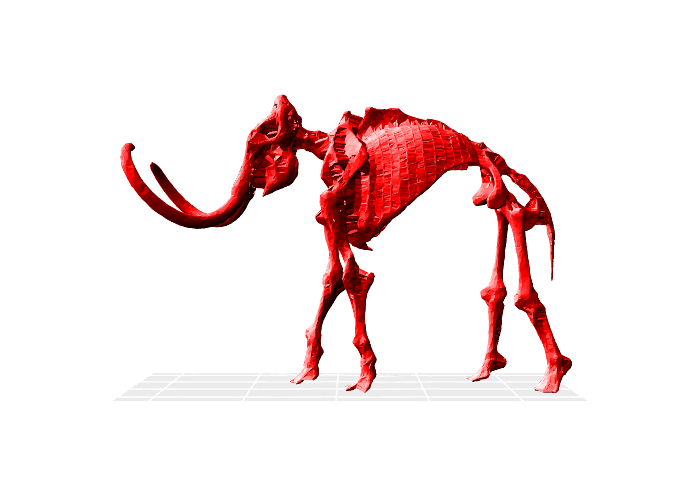
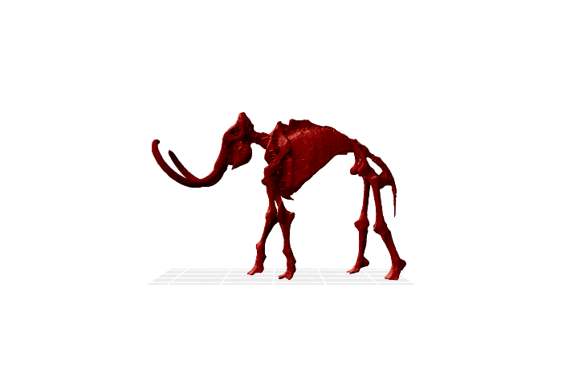
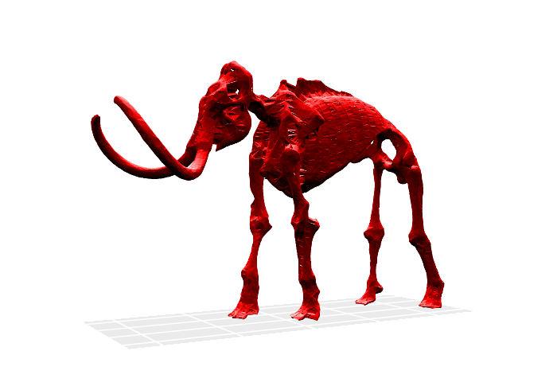
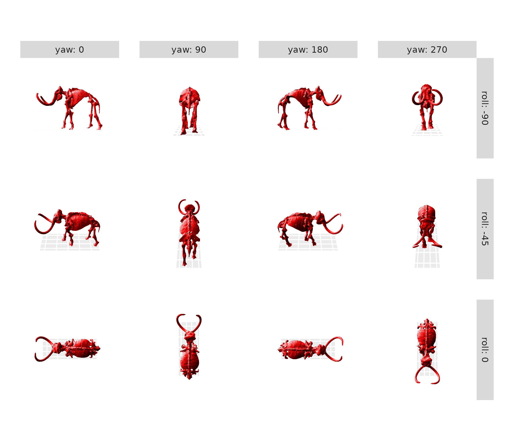
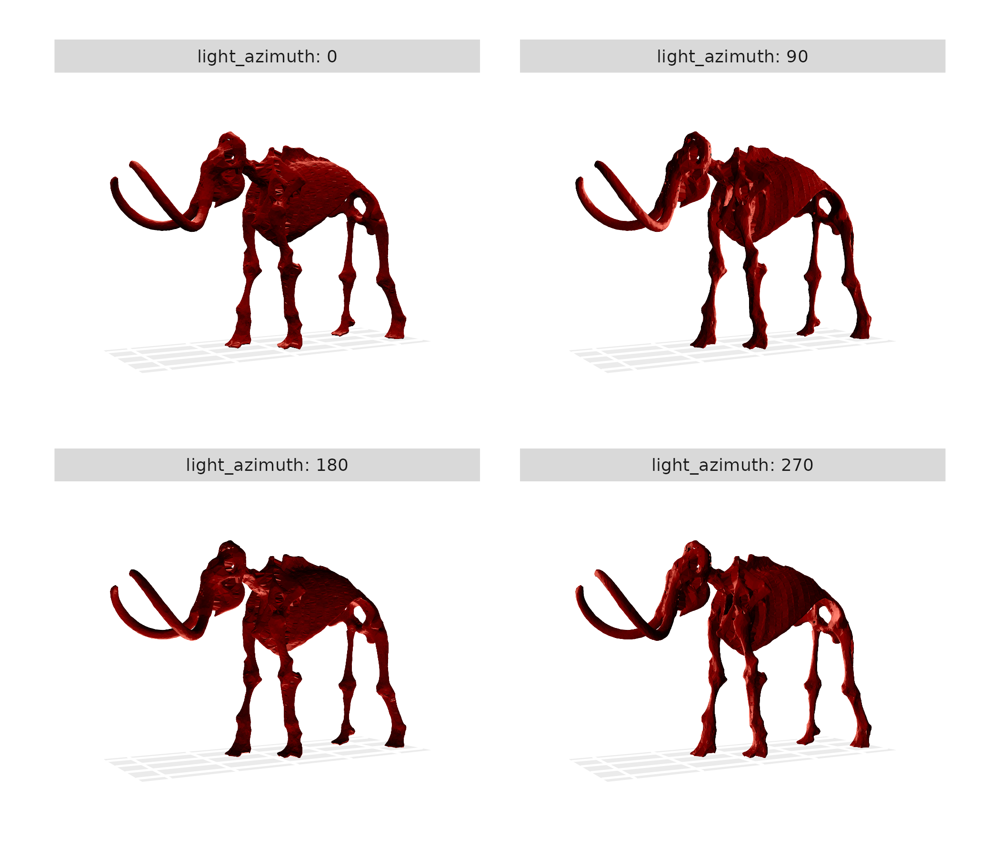

# Animation, orbits, and multiple views

``` r

library(ggcube)
```

Because ggcube renders a 3D scene from a fixed camera angle, a single
plot only ever shows one viewpoint. Two functions let you show more than
one:
[`animate_3d()`](https://matthewkling.github.io/ggcube/reference/animate_3d.md)
moves the camera through a sequence of angles and plays them back as a
GIF or movie, while
[`orbit_3d()`](https://matthewkling.github.io/ggcube/reference/orbit_3d.md)
renders the same kind of sequence (or a 2D grid of rotation angles) into
a HTML “orbit” widget you can drag to rotate. Two facets,
[`facet_wrap_views()`](https://matthewkling.github.io/ggcube/reference/facet_wrap_views.md)
and
[`facet_grid_views()`](https://matthewkling.github.io/ggcube/reference/facet_wrap_views.md),
instead lay out several views side by side in a single static figure.

Animations and orbits can be displayed in RStudio’s viewer, exported and
viewed in a web browser, added to Shiny apps, or knit into RMarkdown
documents like Reveal.js presentations or pkgdown articles.

All of these simply render the plot many times at different rotations,
so they preserve ggcube’s exact look — every frame or panel is a real
ggcube render, with the same lighting, depth sorting, and color scales.

They share a vocabulary of angles: `pitch`, `roll`, and `yaw` for the
camera, and `light_azimuth` and `light_elevation` for the light, as
described in the
[lighting](https://matthewkling.github.io/ggcube/articles/lighting.md)
article.

We’ll use a common base plot throughout this article – an alpha hull of
points from a [mammoth skeleton digitized by the
Smithsonian](https://3d.si.edu/object/3d/mammuthus-primigenius-blumbach:341c96cd-f967-4540-8ed1-d3fc56d31f12):

``` r

mammoth <- data.frame(do.call(rbind, rjson::fromJSON(
  file = paste0("https://raw.githubusercontent.com/PAIR-code/",
                "understanding-umap/master/raw_data/mammoth_3d_50k.json")
)))
colnames(mammoth) <- c("Y", "X", "Z")

p <- ggplot(mammoth, aes(X, Y, Z)) +
      geom_hull_3d(method = "alpha", radius = 8, 
                   fill = "darkred", color = "darkred") +
      light(direction = c(-1, 1, 0), anchor = "camera") +
      coord_3d(roll = -90, scales = "fixed", zoom = 1.1,
               panels = "zmin", expand = FALSE) +
      theme(axis.text = element_blank(),
            axis.ticks = element_blank(),
            axis.title = element_blank())
```

## Animations

[`animate_3d()`](https://matthewkling.github.io/ggcube/reference/animate_3d.md)
takes a plot and a set of keyframe angles, interpolates between them,
and renders the frames into an animation. Each of `pitch`, `roll`, and
`yaw` is either held at a single value or given as a vector of keyframes
to move through; the camera is linearly interpolated between successive
keyframes.

The most common case is a turntable spin — a full `yaw` rotation,
holding the other angles fixed. `nframes` sets the number of rendered
frames and `fps` the playback speed:

``` r

animate_3d(p, yaw = c(0, 360), nframes = 60, fps = 10, width = 700)
```



Keyframes can also trace a more complex path. Here the view moves
through several angles on two axes at once, tilting on the `roll` axis
while it spins in `yaw`:

``` r

animate_3d(p,
           yaw = c(0, 720),
           roll = c(-90, 0, -90),
           nframes = 120, fps = 10, width = 700)
```



The light can move too, with keyframes for `light_azimuth` and
`light_elevation`. Here the camera holds still while the light circles
the mammoth. Because this plot’s light is anchored to the camera, the
azimuth is measured around the view, so the light sweeps around the edge
of the frame:

``` r

animate_3d(p, light_azimuth = c(0, 360), light_elevation = 20,
           nframes = 60, fps = 10, width = 700)
```



Light angles can be animated together with the camera angles. They move
the plot-level light, so they require a directional light (not one
placed with `position`) and can’t be used when a layer sets its own
`light`.

The animation is written to a temporary file and displayed; use
[`anim_save_3d()`](https://matthewkling.github.io/ggcube/reference/anim_save_3d.md)
to save it somewhere permanent. See
[`?animate_3d`](https://matthewkling.github.io/ggcube/reference/animate_3d.md)
for the full set of playback options, including frame timing, pauses,
rewind, alternative renderers, and parallel rendering.

## Interactive orbits

[`orbit_3d()`](https://matthewkling.github.io/ggcube/reference/orbit_3d.md)
also renders a set of plots at different rotation angles, but it instead
packages the frames into an interactive HTML widget that you can drag to
rotate. Clicking and dragging with your cursor, or using your keyboard
arrow keys (after clicking or tab-selecting the plot), changes the
viewing angle.

Rotation is specified the same way as in animation, except that here
each angle is given as a range rather than a keyframe path. Specifying
the range in ascending vs. descending order switches the control
direction; note that for `yaw` specifically, specifying the larger angle
first (e.g. `c(360, 0)`) is generally preferred so that rotation
direction matches drag direction.

Full-turn ranges (e.g. `yaw = c(0, 360)`) wrap around seamlessly, so you
can keep dragging in one direction forever, while partial ranges stop at
their endpoints. Use `start =` to choose the initial angle. Smoothness
is governed by the frame count `n`, with the trade-off that more frames
take longer to render and produce larger files.

Specifying a single range gives a 1D orbit or turntable effect — drag
left and right to spin it:

``` r

orbit_3d(p, yaw = c(360, 0), start = 300,
         n = 36, width = 700)
```

For a 2D orbit, you specify two ranges; horizontal drag turns the plot
on one axis and vertical drag on the other, letting you both spin and
tilt the plot. The two numbers in `n` set the resolution of each axis,
and their product determines the number of rendered frames, so keep them
modest:

``` r

orbit_3d(p, yaw = c(360, 0), roll = c(-90, 0), start = c(yaw = 300),
         n = c(24, 12), readout = TRUE, width = 700)
```

The light angles can be ranged too. When an orbit ranges one camera
angle and one light angle, horizontal drag moves the camera and vertical
drag moves the light:

``` r

orbit_3d(p, yaw = c(360, 0), light_elevation = c(-30, 90), 
         start = c(yaw = 300), n = c(24, 6), width = 700)
```

You can include orbit widgets in Shiny apps via
[`orbit3dOutput()`](https://matthewkling.github.io/ggcube/reference/orbit_3d-shiny.md)
and
[`renderOrbit3d()`](https://matthewkling.github.io/ggcube/reference/orbit_3d-shiny.md);
see the documentation for those functions to learn more.

### Reading off a view

Orbits are also a quick way to find a good angle for a static plot. The
2D orbit above was made with `readout = TRUE`, so it shows the angles of
the current view in its top-left corner. Drag until you like the view,
then copy those angles into your plot’s
[`coord_3d()`](https://matthewkling.github.io/ggcube/reference/coord_3d.md)
call. Pressing `r` on any orbit (after clicking it) shows or hides the
readout, so you can turn it on even for an orbit made without
`readout = TRUE`.

The readout always lists `pitch`, `roll`, and `yaw`, and adds the
light’s azimuth and elevation when the orbit moves the light; those can
be used in `light(direction = direction(azimuth, elevation))`. Angles
are shown in the terms of the ranges you gave, so an orbit over
`yaw = c(360, 0)` reports values between 0 and 360.

## Multiple views

[`facet_wrap_views()`](https://matthewkling.github.io/ggcube/reference/facet_wrap_views.md)
and
[`facet_grid_views()`](https://matthewkling.github.io/ggcube/reference/facet_wrap_views.md)
show the views side by side as a static figure, which is handy for
comparing views at a glance or in print. They work like
[`facet_wrap()`](https://ggplot2.tidyverse.org/reference/facet_wrap.html)
and
[`facet_grid()`](https://ggplot2.tidyverse.org/reference/facet_grid.html),
except that the formula names viewing angles rather than data variables,
and every panel shows all of the data from its own angle. Here roll
varies down the rows and yaw across the columns:

``` r

p + facet_grid_views(roll ~ yaw, n = c(3, 4))
```



Each angle in the formula is sampled at `n` evenly spaced values, over a
default range that suits it: a full turn for `yaw`, and from a side view
to looking straight down for `roll`. Set an angle’s range with the
argument of the same name, such as `yaw = c(-90, 90)`, or fix an angle
that isn’t in the formula with a single value, such as `roll = -45`.
Every panel is framed the same way, so the plot keeps its size from
panel to panel.

Light angles can be faceted too, which makes it easy to compare a few
lighting directions from a fixed view:

``` r

p + facet_wrap_views(~light_azimuth)
```



Since these are facets, the usual ggplot2 tools apply: `labeller`
changes the strip labels, `nrow` and `ncol` rearrange a wrapped
sequence, and themes style the strips and spacing. Several angles can
also be crossed, as in `roll ~ yaw + light_azimuth`. A plot can only
have one facet, though, so view facets can’t be combined with faceting
by data variables.

## Computational considerations

Pre-rendering dozens or hundreds of frames can take some time, and can
generate large files. If needed, you can speed up rendering of
animations and orbits using parallelization, via the `cores` parameter.
You can also reduce the number of frames with the `n` parameter, and
change the size of the resulting images with `width`/`height`. View
facets don’t write any files, but each panel is a full render, so a
large grid of a complex plot also takes a while to draw.
