# Controlling the 3D view

``` r

library(ggcube)
library(patchwork)
```

[`coord_3d()`](https://matthewkling.github.io/ggcube/reference/coord_3d.md)
is the core of every ggcube plot. It controls how 3D data is rotated,
projected, framed, and decorated. This article walks through each of its
parameters in detail.

We’ll use a common base plot throughout. For clarity, let’s suppress the
axis text and add arrows at the positive ends of the axis lines:

``` r

p <- ggplot() +
  geom_function_3d(
    fun = function(x, y) sin(x) * cos(y),
    xlim = c(-pi, pi), ylim = c(-pi, pi), n = 50) +
  light("hard", shadow = .6, highlight = .4) +
  scale_fill_viridis_c() +
  theme_light() +
  theme(legend.position = "none",
        axis.text = element_blank(),
        axis.line = element_line(color = "black", 
                                 arrow = arrow(20, unit(.1, "in"), type = "closed")))
```

## Rotation

The plot’s rotation in 3D space can be specified in three different
ways: Euler angles, viewing vectors, or viewing angles.

### Euler angles

One way to specify the rotation is by providing three angles, `pitch`,
`roll`, and `yaw`, which rotate the plot around the x-, y-, and z-axes,
respectively. All are specified in degrees. When they’re all zero, the
plot resembles a standard 2D plot (+x = right, +y = up, +z = toward
viewer). The defaults (`pitch = 0`, `roll = -60`, `yaw = -30`) give an
overhead corner view that can work well for many plots.

Here are a variety of rotations showing the default, the zero-rotation
case, the effect of setting each rotation angle individually while the
others are held at zero, and an example combining them to achieve an
arbitrary rotation (note this uses the `patchwork` library to produce a
mutlti-panel plot):

``` r

(p + coord_3d() + ggtitle("Default")) +
  (p + coord_3d(pitch = 0, roll = 0, yaw = 0) + ggtitle("All angles 0")) +
  (p + coord_3d(pitch = 20, roll = 40, yaw = 60) + ggtitle("Arbitrary combination")) +
  (p + coord_3d(pitch = 30, roll = 0, yaw = 0) + ggtitle("pitch = 30")) +
  (p + coord_3d(pitch = 0, roll = 30, yaw = 0) + ggtitle("roll = 30")) +
  (p + coord_3d(pitch = 0, roll = 0, yaw = 30) + ggtitle("yaw = 30")) +
  plot_layout(nrow = 2)
```

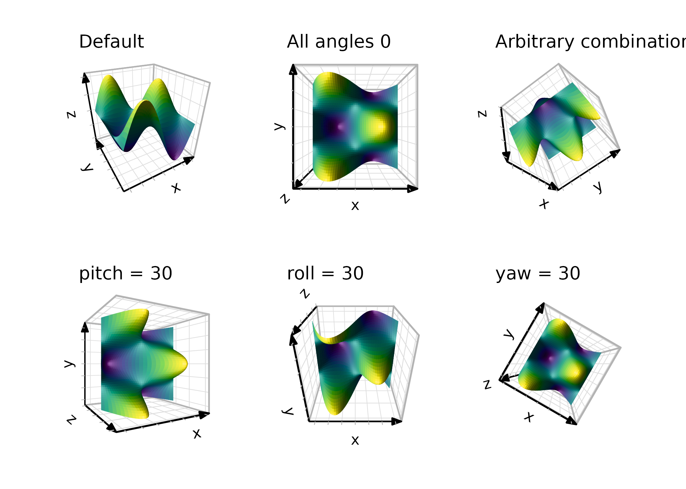

### Viewing direction

Instead of rotation angles, you can give the `direction` the plot is
viewed *from*, as a vector `c(x, y, z)` in the same orientation as the
data axes. Only the direction of the vector matters, not its length, so
`c(1, 1, 1)` and `c(2, 2, 2)` both view the cube from its xmax-ymax-zmax
corner. The plot is turned so that the z axis points up the page, or,
when looking straight down the z axis, so that the y axis points up.

``` r

(p + coord_3d(direction = c(0, 0, 1)) + ggtitle("c(0, 0, 1)")) +
  (p + coord_3d(direction = c(1, 1, 1)) + ggtitle("c(1, 1, 1)")) +
  (p + coord_3d(direction = c(-1, -1, 1)) + ggtitle("c(-1, -1, 1)")) +
  (p + coord_3d(direction = c(0, -1, 0)) + ggtitle("c(0, -1, 0)")) +
  (p + coord_3d(direction = c(1, 0, 0.5)) + ggtitle("c(1, 0, 0.5)")) +
  (p + coord_3d(direction = c(1, -1, -1)) + ggtitle("c(1, -1, -1)")) +
  plot_layout(nrow = 2)
```

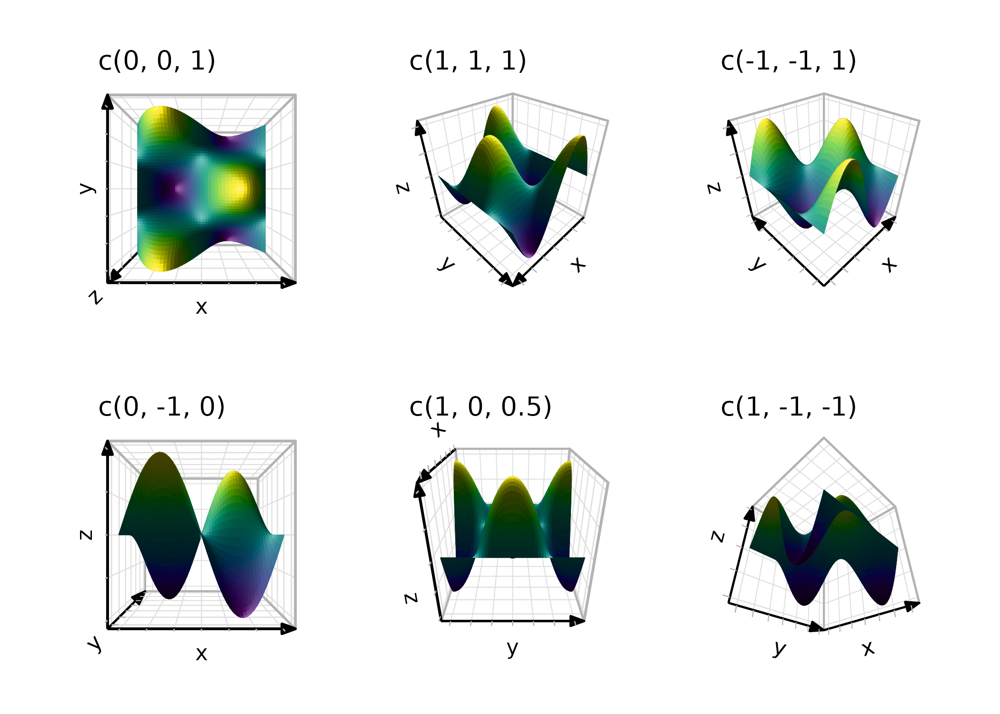

Because a direction only says where the viewer is, it can’t express a
view that is tilted sideways; use `pitch`, `roll`, and `yaw` to achieve
that. Supplying `direction` together with any of the rotation angles is
an error.

### Viewing angles

If you’d rather think in angles, you can pass an azimuth and an
elevation to
[`direction()`](https://matthewkling.github.io/ggcube/reference/direction.md),
which builds a vector you can use for `direction`. Azimuth is a compass
bearing, measured clockwise from the positive y axis, and elevation is
the angle above the xy plane, both specified in degrees. The default
view, for example, is from an azimuth of 210 and an elevation of 30, so
`coord_3d(direction = direction(210, 30))` gives the same plot as
[`coord_3d()`](https://matthewkling.github.io/ggcube/reference/coord_3d.md):

``` r

direction(210, 30)
#> [1] -0.4330127 -0.7500000  0.5000000
```

## Finding a view

Choosing angles by trial and error can be slow. Two tools help: the
facet functions
[`facet_wrap_views()`](https://matthewkling.github.io/ggcube/reference/facet_wrap_views.md)
and
[`facet_grid_views()`](https://matthewkling.github.io/ggcube/reference/facet_wrap_views.md)
lay out a grid of views side by side for comparison, and
[`orbit_3d()`](https://matthewkling.github.io/ggcube/reference/orbit_3d.md)
lets you interactively rotate the plot read the angles of the current
view, ready to copy into
[`coord_3d()`](https://matthewkling.github.io/ggcube/reference/coord_3d.md).
See the [animation and multiple
views](https://matthewkling.github.io/ggcube/articles/animation.md)
article for details on both.

## Perspective and distance

By default,
[`coord_3d()`](https://matthewkling.github.io/ggcube/reference/coord_3d.md)
uses perspective projection, where objects farther from the viewer
appear smaller. The `dist` parameter controls the camera distance from
the center of the data cube — larger values produce less distortion. Set
`persp = FALSE` to switch to orthographic projection, where parallel
lines in 3D remain parallel in the 2D rendering. Orthographic projection
is equivalent to viewing from infinite distance and can be useful for
technical or schematic plots.

``` r

(p + coord_3d(yaw = 45, dist = 1.1) + ggtitle("dist = 1.1")) +
  (p + coord_3d(yaw = 45, dist = 2) + ggtitle("dist = 2")) +
  (p + coord_3d(yaw = 45, persp = FALSE) + ggtitle("persp = FALSE")) +
  plot_layout(ncol = 3)
```

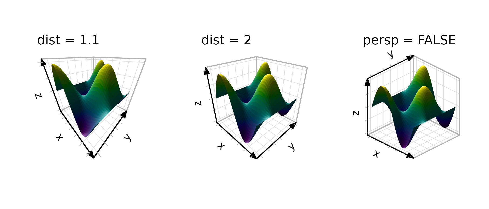

Perspective projection enlarges nearby objects and shrinks more distant
objects. For graphical objects whose size is defined by spatial
coordinates (like the polygon tiles in the figure above), this resizing
always happens because it is inherent to the data projection. For
properties like line widths and point and text sizes, a separate “depth
scaling” process changes their sizing to apply perspective. You can
adjust or switch off this latter behavior by specifying the
`scale_depth` parameter in an individual geom/stat function (to control
scaling for the data layer) or in
[`coord_3d()`](https://matthewkling.github.io/ggcube/reference/coord_3d.md)
(to control scaling of the gridlines, ticks, and axis text).

## Aspect ratios and scale matching

The `scales` parameter controls how data ranges map to visual cube
dimensions. With `"free"` (the default), each axis is stretched
independently to fill its dimension of the cube, maximizing the visual
range for each variable. With `"fixed"`, the visual proportions match
the data proportions, analogous to
[`coord_fixed()`](https://ggplot2.tidyverse.org/reference/coord_fixed.html)
in 2D:

``` r

(p + coord_3d(scales = "free") + ggtitle('scales = "free"')) +
  (p + coord_3d(scales = "fixed") + ggtitle('scales = "fixed"')) +
  plot_layout(ncol = 2) & theme_light()
```

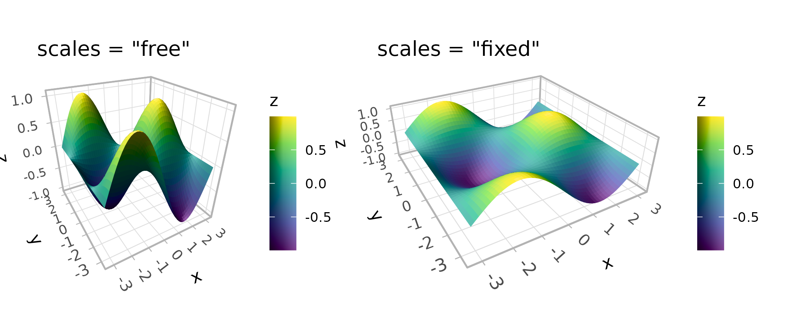

The `ratio` parameter sets custom relative lengths for the three axes.
With `"free"` scales, ratios are applied to the standardized cube
coordinates. With `"fixed"` scales, they’re applied to the data
coordinates:

``` r

(p + coord_3d(scales = "free", ratio = c(1, 3, 1)) +
    ggtitle('free, ratio = c(1, 3, 1)')) +
  (p + coord_3d(scales = "fixed", ratio = c(1, 3, 1)) +
      ggtitle('fixed, ratio = c(1, 3, 1)')) +
  plot_layout(ncol = 2) & theme_light()
```

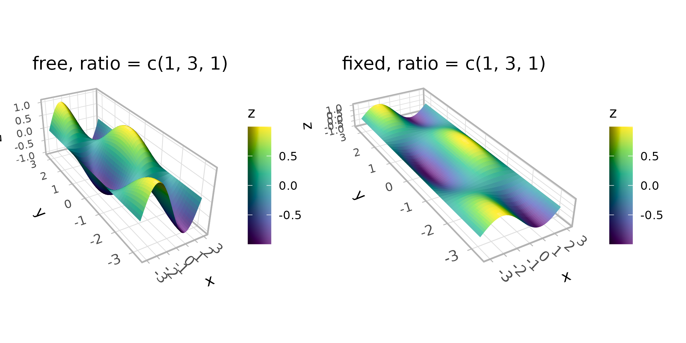

## Zooming, clipping, and expansion

`zoom` adjusts the overall framing without changing the rotation or
projection. Values less than 1 zoom out (more whitespace), while values
greater than 1 zoom in (tighter framing).

The `clip` parameter controls whether graphical elements can be drawn
outside the panel area (ggplot2’s rectangular canvas, not the projected
3D panel). The default `"off"` allows this, which is generally
recommended for 3D plots where elements may extend beyond the projected
panel area.

``` r

(p + coord_3d(zoom = 0.7) + ggtitle("zoom = 0.7")) +
  (p + coord_3d(zoom = 1) + ggtitle("zoom = 1\n(default)")) +
  (p + coord_3d(zoom = 1.5, clip = "on") + ggtitle('zoom = 1.5\nclip = "on"')) +
  plot_layout(ncol = 3)
```

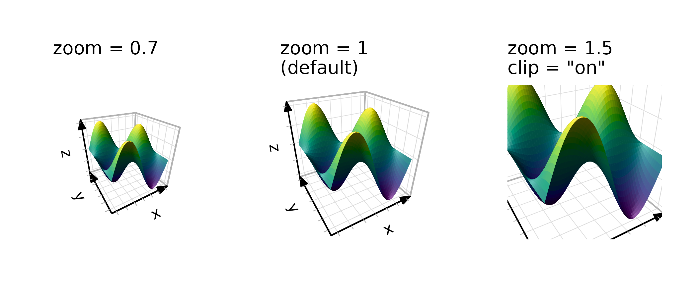 The `expand` parameter works
like the `expand` argument in standard ggplot2 scales — when `TRUE` (the
default), axis ranges are padded slightly beyond the data range. You can
fine-tune expansion per axis using the standard scale functions.

``` r

(p + coord_3d(expand = TRUE) + ggtitle("expand = TRUE (default)")) +
  (p + coord_3d(expand = FALSE) + ggtitle("expand = FALSE")) +
  plot_layout(ncol = 2)
```

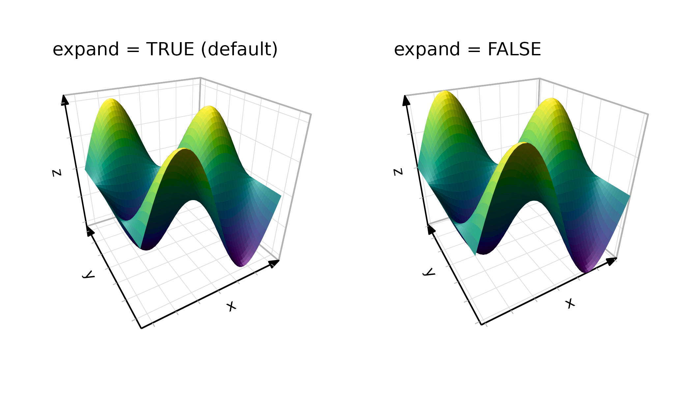

## Panel selection

The `panels` argument controls which faces of the cube are drawn. The
six faces are named `"xmin"`, `"xmax"`, `"ymin"`, `"ymax"`, `"zmin"`,
and `"zmax"`. Depending on the rotation, some faces lie behind the data
(“background” panels) and some lie in front (“foreground” panels). By
default, only background panels are drawn. When drawn, foreground panels
default to 20% opacity so they don’t obscure the data; their styling is
controlled via theme elements (see the theming section below).

You can request specific faces by name, show all faces, or hide them
entirely:

``` r

(p + coord_3d(panels = "background") + ggtitle('"background" (default)')) +
  (p + coord_3d(panels = c("xmin", "xmax", "zmax")) +
      ggtitle('c("xmin", "xmax", "zmax")')) +
  (p + coord_3d(panels = "all") + ggtitle('"all"')) +
  (p + coord_3d(panels = "none") + ggtitle('"none"')) +
  plot_layout(ncol = 2)
```

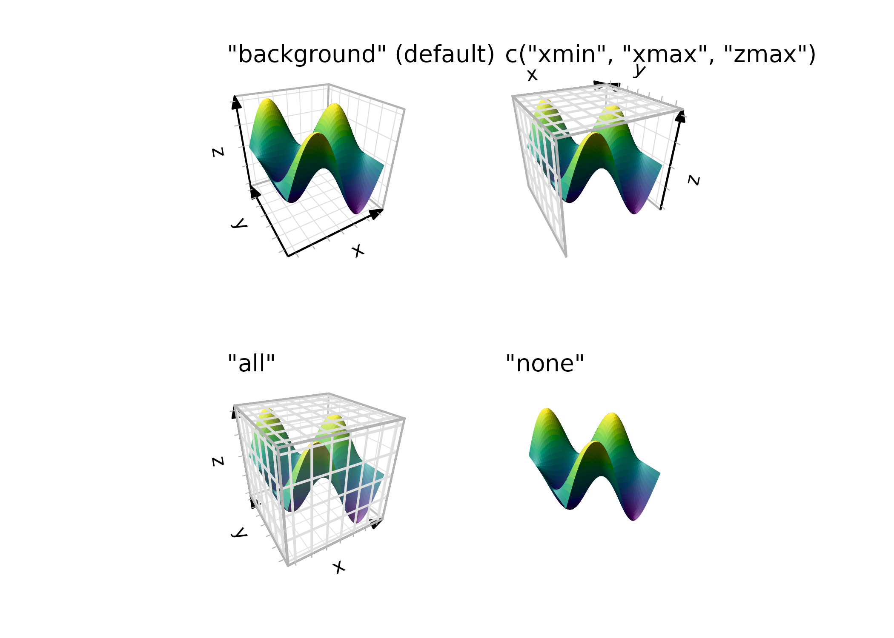

## Axis label placement

Axis furnishings, including lines, ticks, text, and titles, *belong to
panels*. This means they can only be drawn on panels that are themselves
visible (see above).

The `xlabels`, `ylabels`, and `zlabels` parameters control where axis
tick labels and titles are placed. Each axis potentially has multiple
possible edges where labels could appear, depending on which faces are
visible. The default `"auto"` uses a heuristic that prioritizes edges on
the periphery of the plot for readability.

For manual control, pass a length-2 character vector naming two adjacent
faces — the shared edge between them is where the labels go. The first
face determines the alignment plane:

``` r

(p + coord_3d() + ggtitle("auto (default)")) +
  (p + coord_3d(xlabels = c("ymax", "zmax"),
                zlabels = c("xmax", "ymin")) +
      ggtitle("manual placement")) +
  plot_layout(ncol = 2) & theme_light()
```

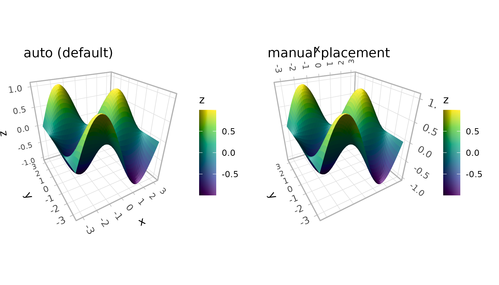

The `rotate_labels` parameter controls whether labels automatically
rotate to align with the projected axis direction. Setting it to `FALSE`
uses the angle specified in theme settings instead:

``` r

(p + coord_3d(rotate_labels = TRUE) + ggtitle("rotate_labels = TRUE")) +
  (p + coord_3d(rotate_labels = FALSE) + ggtitle("rotate_labels = FALSE")) +
  plot_layout(ncol = 2) & theme_light()
```

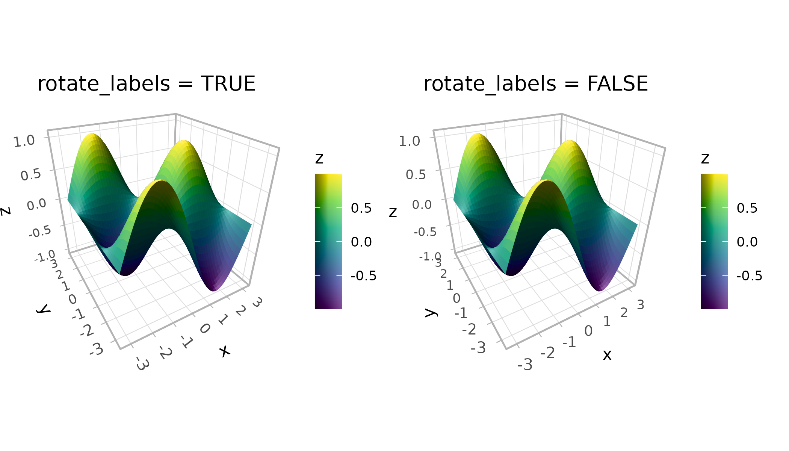

The `title_position` parameter affects axis titles that fall on internal
(non-peripheral) edges. `"auto"` places them at the near end of the axis
outside the plot area, while `"center"` centers them along the edge.

## Theming the 3D cube

Standard ggplot2 themes work with ggcube. Adding a complete theme
behaves as expected:

``` r

(p + coord_3d() + theme_dark() + ggtitle("theme_dark()")) +
  (p + coord_3d() + theme_minimal() + ggtitle("theme_minimal()")) +
  plot_layout(ncol = 2)
```

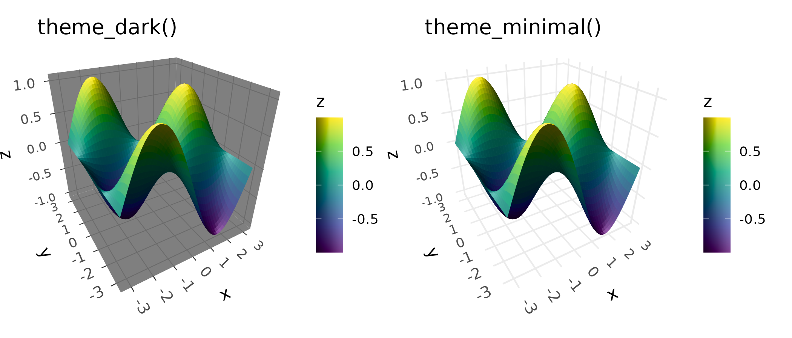

ggcube also adds several theme elements for 3D-specific styling. One
important category is foreground panel elements, which control cube
faces rendered in front of the data. These inherit from their background
counterparts, so styling `panel.background` affects both background and
foreground faces, while `panel.foreground` targets only the front faces.
ggcube’s
[`element_rect()`](https://matthewkling.github.io/ggcube/reference/element_rect.md)
extends ggplot2’s version with an `alpha` parameter for transparency.
This is particularly useful for foreground panels — the default
`panel.foreground` uses `alpha = 0.2` so front faces don’t obscure the
data:

``` r

p +
  coord_3d(panels = "all") +
  theme_gray() +
  theme(panel.border = element_rect(color = "black"),
        panel.foreground = element_rect(alpha = .3),
        panel.grid.foreground = element_line(color = "gray", linewidth = .25))
```

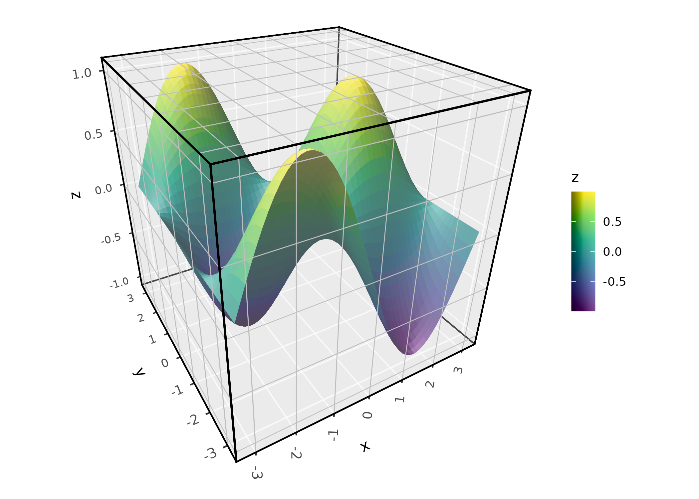

For axis labels, ggcube adds `axis.text.z` and `axis.title.z` elements
that inherit from `axis.text` and `axis.title` respectively.

By default, axis text, ticks, and grid lines get their sizes/widths
scaled to apply depth perspective. This can be controlled with
`coord_3d(scale_depth = )`; see the documentation for details. Axis
titles are not scaled by depth.

The `margin` argument to
[`element_text()`](https://ggplot2.tidyverse.org/reference/element.html)
controls padding between titles, labels, and cube edges.

``` r

p +
  coord_3d(panels = "all") +
  theme(panel.background = element_rect(color = "black"),
        panel.border = element_rect(color = "black"),
        panel.foreground = element_rect(alpha = .3),
        panel.grid.foreground = element_line(color = "gray", linewidth = .25),
        axis.text = element_text(color = "darkblue", size = 12),
        axis.text.z = element_text(color = "darkred"),
        axis.title = element_text(margin = margin(t = 30)),
        axis.title.x = element_text(color = "magenta"))
```

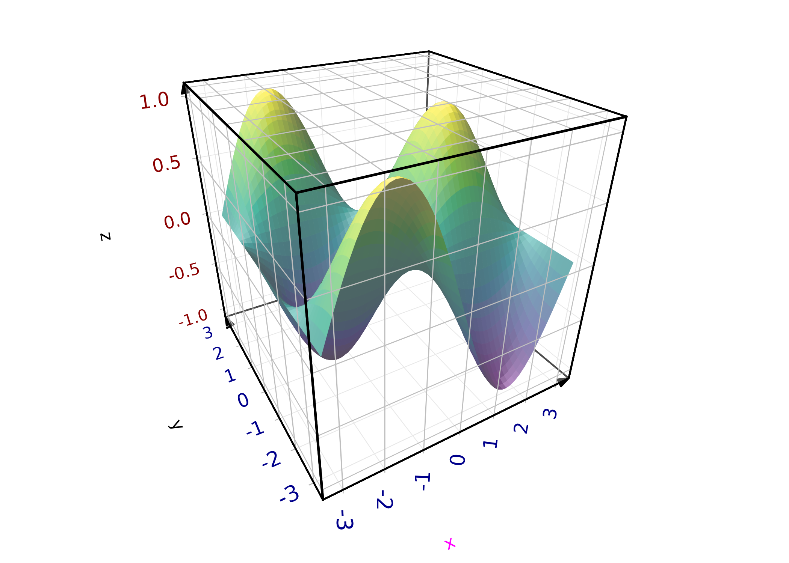

The full set of 3D-specific theme elements:

- **`panel.foreground`**: Fill and border for foreground cube faces
  (inherits from `panel.background`)
- **`panel.border.foreground`**: Border for foreground faces (inherits
  from `panel.border`)
- **`panel.grid.foreground`**: Grid lines on foreground faces (inherits
  from `panel.grid`)
- **`panel.grid.major.foreground`**: Major grid lines on foreground
  faces (inherits from `panel.grid.foreground`)
- **`axis.line.z`**: Z-axis line (inherits from `axis.line`)
- **`axis.ticks.z`**: Z-axis tick (inherits from `axis.ticks`)
- **`axis.text.z`**: Z-axis tick labels (inherits from `axis.text`)
- **`axis.title.z`**: Z-axis title (inherits from `axis.title`)
