# Introduction to ggcube

ggcube is a ggplot2 extension for 3D plotting. It provides 3D geoms,
stats, and a 3D coordinate system that let you build 3D visualizations
using the familiar ggplot2 grammar: map your data to aesthetics, add
layers, and customize the result with scales, guides, and themes.

3D plots can be excellent for exploration, communication, and art. But
it’s important to note that they can also give a distorted or obscured
view of the data — 2D alternative are generally recommended when precise
quantitative data representation is important.

``` r

library(ggcube)
```

## The basics

The essential ingredient of a ggcube plot is
[`coord_3d()`](https://matthewkling.github.io/ggcube/reference/coord_3d.md).
Adding it to a standard ggplot that includes a `z` aesthetic creates a
3D plot:

``` r

ggplot(mpg, aes(x = displ, y = hwy, z = drv, color = class)) +
      geom_point() +
      coord_3d()
```

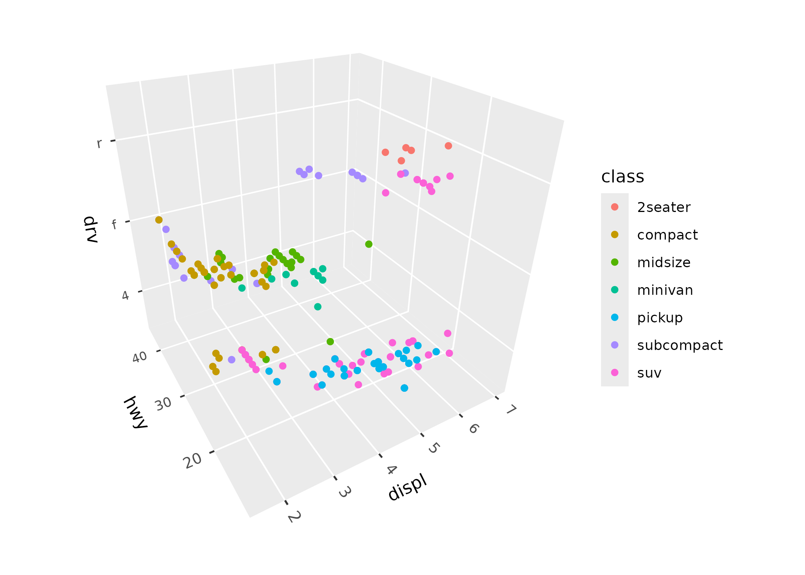

Some standard ggplot2 layers like
[`geom_point()`](https://ggplot2.tidyverse.org/reference/geom_point.html)
work in 3D automatically. ggcube also provides 3D-specific layer
functions for surfaces, paths, volumes, and text, described below.

## Controlling the view

[`coord_3d()`](https://matthewkling.github.io/ggcube/reference/coord_3d.md)
controls how the 3D scene is projected onto 2D. Rotation is specified
via three angles — `pitch` (tilt around the x-axis), `roll` (tilt around
the y-axis), and `yaw` (spin around the z-axis):

``` r

ggplot(mpg, aes(displ, hwy, drv, color = class)) +
      geom_point() +
      coord_3d(pitch = 0, roll = 60, yaw = 0, dist = 1.4,
               ratio = c(2, 1, 1), panels = "all") +
      theme(panel.border = element_rect(color = "black"),
            panel.foreground = element_rect(alpha = .1))
```

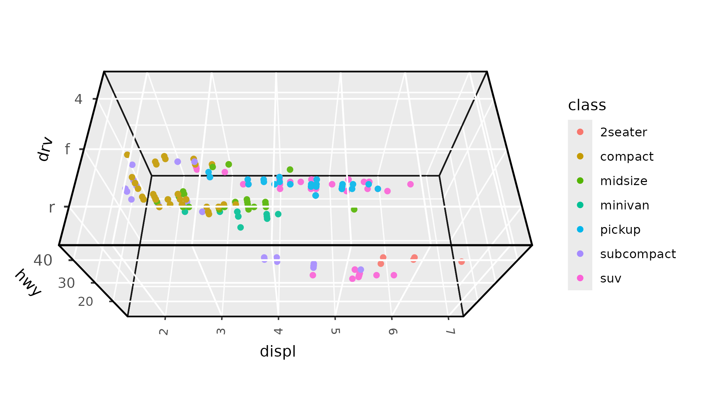

Alternatively, `direction` gives the direction the plot is viewed from
as a vector: `coord_3d(direction = c(1, 1, 1))` looks at the cube from
its xmax-ymax-zmax corner. The
[`direction()`](https://matthewkling.github.io/ggcube/reference/direction.md)
helper builds such vectors from an azimuth and an elevation, for both
views and lights.

Perspective projection is on by default, making distant objects appear
smaller. The `dist` parameter controls the strength of this effect
(larger values = less distortion), and `persp = FALSE` switches to
orthographic projection where parallel lines stay parallel.

The `scales` parameter controls how axis ranges map to visual size.
`"free"` (the default) stretches each axis independently to fill the
cube, while `"fixed"` preserves the relative scale of the data (like
[`coord_fixed()`](https://ggplot2.tidyverse.org/reference/coord_fixed.html)
in 2D). The `ratio` parameter lets you set custom proportions for the
three axes. And `zoom` adjusts overall framing without changing the
rotation or projection.

See the [3D
view](https://matthewkling.github.io/ggcube/articles/coord_3d.html)
article for a comprehensive guide to all view parameters.

## 3D layers

Most standard ggplot2 geoms are designed around 2D coordinate
assumptions, and won’t render correctly with
[`coord_3d()`](https://matthewkling.github.io/ggcube/reference/coord_3d.md).
(An exception is
[`geom_point()`](https://ggplot2.tidyverse.org/reference/geom_point.html),
which works out of the box as shown above, albeit with ordering and
sizing limitations.) ggcube provides a range of 3D-native layer
functions that cover common 3D plot types, including points, surfaces,
bars, paths, and text.

Here’s a quick tour of the main categories.

### Surfaces

Several geoms and stats work together to render surfaces with a z value
for every (x, y) position.
[`geom_surface_3d()`](https://matthewkling.github.io/ggcube/reference/stat_surface_3d.md)
renders data as a tessellated surface,
[`geom_contour_3d()`](https://matthewkling.github.io/ggcube/reference/geom_contour_3d.md)
creates layer-cake contour stacks, and
[`geom_ridgeline_3d()`](https://matthewkling.github.io/ggcube/reference/geom_ridgeline_3d.md)
shows cross-sectional slices:

``` r

ggplot(mountain, aes(x, y, z)) +
      geom_surface_3d(aes(fill = z)) +
      scale_fill_viridis_c() +
      coord_3d(ratio = c(1.5, 2, 1), expand = FALSE, panels = "zmin") +
      light(direction = c(1, 0, 0)) +
      theme_light()
```

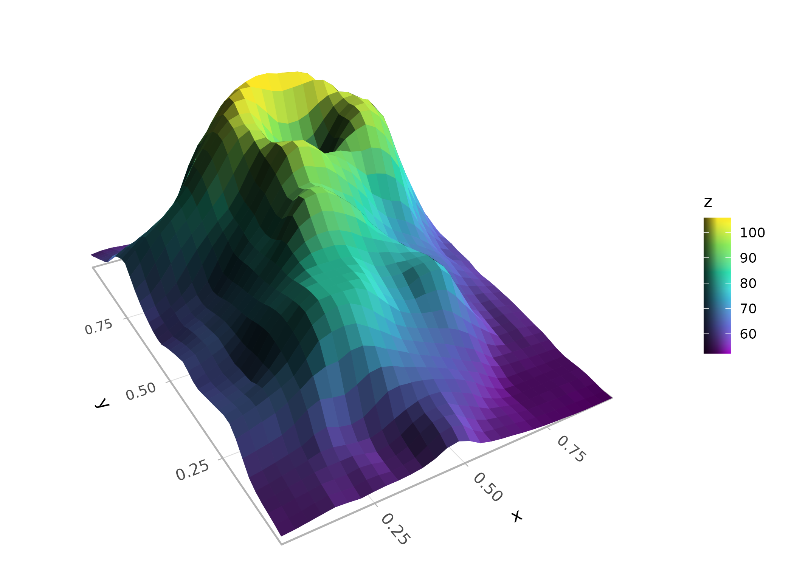

Stats like
[`stat_function_3d()`](https://matthewkling.github.io/ggcube/reference/stat_function_3d.md),
[`stat_smooth_3d()`](https://matthewkling.github.io/ggcube/reference/geom_smooth_3d.md),
and
[`stat_density_3d()`](https://matthewkling.github.io/ggcube/reference/stat_density_3d.md)
generate surface data from functions, model fits, or kernel density
estimates. These stats can be paired with any of the surface geoms. See
the [3D
surfaces](https://matthewkling.github.io/ggcube/articles/surfaces.html)
article for more detail on surface plotting options.

### Volumes

ggcube’s volume functions draw surfaces that bound regions of 3D space.
Unlike terrain, these surfaces can fold over, nest inside one another,
and close on themselves.
[`geom_hull_3d()`](https://matthewkling.github.io/ggcube/reference/geom_hull_3d.md)
computes and renders triangulated hulls from 3D point clouds, including
convex and alpha hulls. The other volume functions are each an “iso”
variant of one of the lower-dimensional surface functions mentioned
above:
[`geom_isosurface_3d()`](https://matthewkling.github.io/ggcube/reference/geom_isosurface_3d.md)
draws surfaces on preexisting 3D gridded data,
[`geom_isofunction_3d()`](https://matthewkling.github.io/ggcube/reference/geom_isofunction_3d.md)
draws mathematical functions, and
[`geom_isodensity_3d()`](https://matthewkling.github.io/ggcube/reference/geom_isodensity_3d.md)
draws density contours of 3D point clouds.

``` r

gyroid <- function(x, y, z) sin(x) * cos(y) + sin(y) * cos(z) + sin(z) * cos(x)
ggplot() +
      geom_isofunction_3d(fun = gyroid, cap = TRUE, fill = "#993333", n = 40,
                          xlim = c(0, 4 * pi), ylim = c(0, 4 * pi), zlim = c(0, 4 * pi)) +
      coord_3d() + theme_void()
```

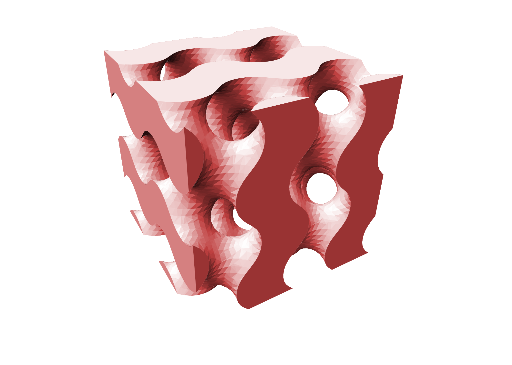

See the [3D
volumes](https://matthewkling.github.io/ggcube/articles/volumes.html)
article for details.

### Points

[`geom_point_3d()`](https://matthewkling.github.io/ggcube/reference/geom_point_3d.md)
extends scatter plots with depth-scaled point sizes (closer points shown
larger) and proper depth sorting (closer points plotted on top). To show
where points lie in 3D, add drop lines to cube faces with
[`geom_dropline_3d()`](https://matthewkling.github.io/ggcube/reference/geom_dropline_3d.md),
and project the points onto those faces with
[`position_on_face()`](https://matthewkling.github.io/ggcube/reference/position_on_face.md),
drawing them as markers lying flat on the faces with `flat = TRUE`:

``` r

ggplot(mpg, aes(x = displ, y = hwy, z = drv, fill = class)) +
      geom_dropline_3d(faces = c("ymax", "xmax")) +
      geom_point_3d(position = position_on_face(c("ymax", "xmax")), flat = TRUE,
                    size = 3, shape = 21, stroke = .1, alpha = .5, show.legend = FALSE) +
      geom_point_3d(size = 3, shape = 21, color = "black", stroke = .1) +
      coord_3d()
```

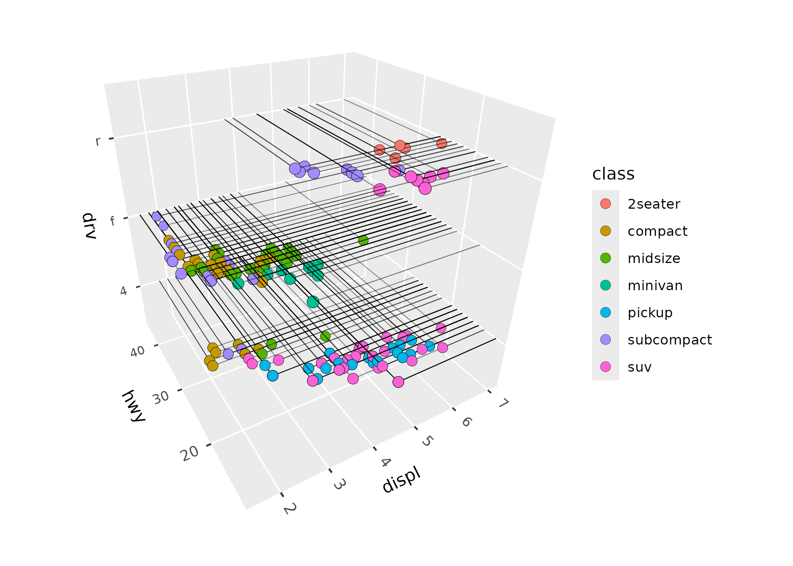

### Lines

[`geom_path_3d()`](https://matthewkling.github.io/ggcube/reference/geom_path_3d.md)
connects observations with depth-sorted, depth-scaled line segments:

``` r

x <- seq(0, 20*pi, pi/16)
spiral <- data.frame(x = x, y = sin(x), z = cos(x), time = 1:length(x))
ggplot(spiral, aes(x, y, z, color = time)) +
      geom_path_3d() +
      scale_color_gradientn(colors = c("blue", "purple", "red", "orange")) +
      coord_3d() +
      theme_light()
```

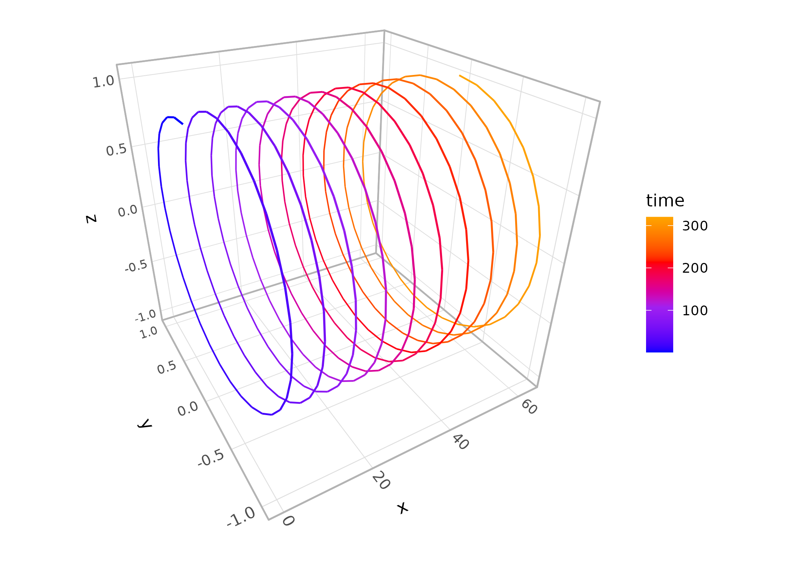

[`geom_segment_3d()`](https://matthewkling.github.io/ggcube/reference/geom_segment_3d.md)
is also available for drawing individual segments defined by start and
end coordinates.

### Prisms

[`geom_col_3d()`](https://matthewkling.github.io/ggcube/reference/geom_col_3d.md)
produces 3D column charts,
[`geom_bar_3d()`](https://matthewkling.github.io/ggcube/reference/geom_bar_3d.md)
creates 3D histograms with automatic binning, and
[`geom_voxel_3d()`](https://matthewkling.github.io/ggcube/reference/geom_voxel_3d.md)
renders arrays of cubes:

``` r

ggplot(iris, aes(Species, Sepal.Length, fill = Species)) +
      geom_bar_3d(bins = 20, width = c(.5, 1)) +
      coord_3d(scales = "fixed", ratio = c(1, 3, .25), yaw = 60) +
      scale_z_continuous(expand = c(0, 0)) +
      theme(legend.position = "none")
```

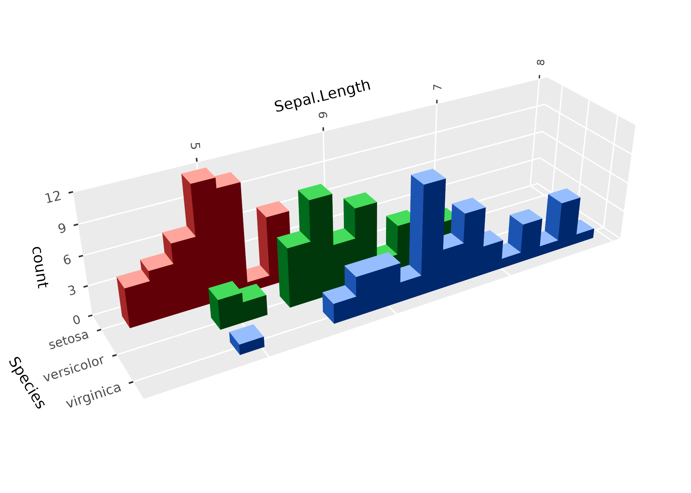

### Distributions

[`stat_distributions_3d()`](https://matthewkling.github.io/ggcube/reference/stat_distributions_3d.md)
computes 1D kernel density estimates per group and arranges them as
ridgeline surfaces, the 3D analog of `ggridges::geom_density_ridges()`:

``` r

ggplot(iris, aes(y = Sepal.Length, x = Species, fill = Species)) +
      stat_distributions_3d() +
      scale_z_continuous(expand = expansion(mult = c(0, NA))) +
      coord_3d() +
      theme(legend.position = "none")
```

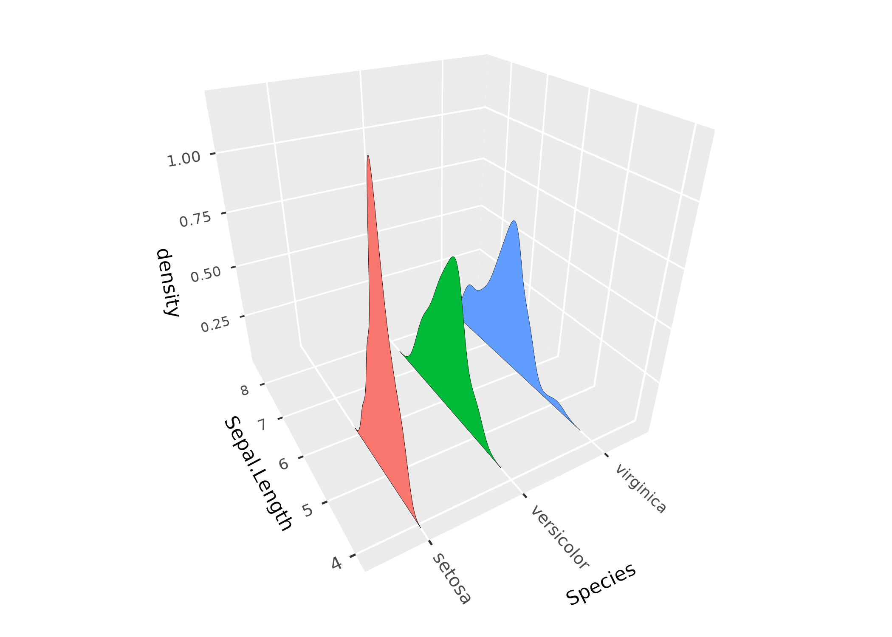

### Text

[`geom_text_3d()`](https://matthewkling.github.io/ggcube/reference/geom_text_3d.md)
renders text in 3D, either as “billboard” labels that always face the
camera, or as polygon outlines that can be oriented in any direction:

``` r

df <- expand.grid(x = c("H", "B"), y = c("a", "o", "u"), z = c("g", "t"))
df$label <- paste0(df$x, df$y, df$z)
ggplot(df, aes(x, y, z, label = label, fill = x)) +
      geom_text_3d(method = "polygon", facing = "zmax",
                   size = 5, weight = "bold") +
      coord_3d(scales = "fixed", light = NULL)
```

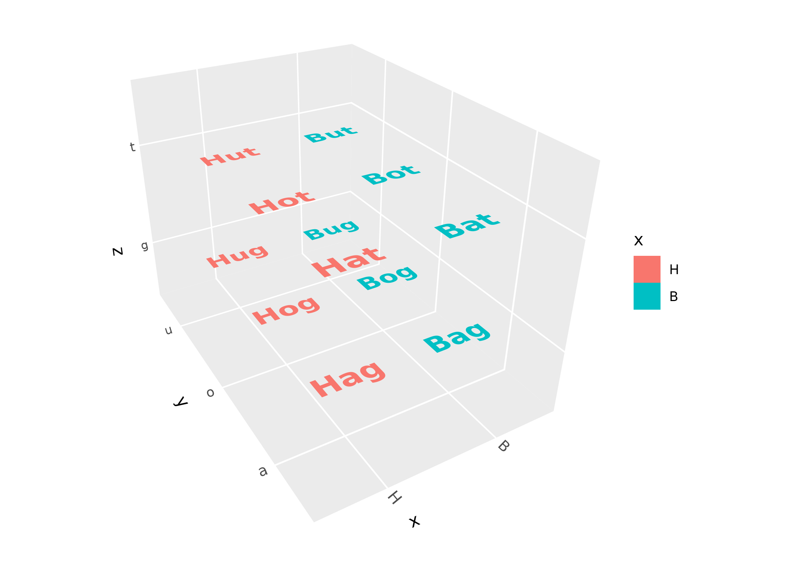

## Lighting

Lighting modifies the fill and/or color of polygon faces based on their
orientation relative to a light source, giving surfaces a sense of depth
and shape. It’s controlled via the
[`light()`](https://matthewkling.github.io/ggcube/reference/light.md)
function, which can be added to a plot or passed to
[`coord_3d()`](https://matthewkling.github.io/ggcube/reference/coord_3d.md)
(applying to all layers) or passed to individual layer functions
(overriding the plot-level setting):

``` r

p <- ggplot() +
      geom_isofunction_3d(fun = function(x, y, z) x^2 + y^2 + z^2 - 1,
                          xlim = c(-1.1, 1.1), ylim = c(-1.1, 1.1), zlim = c(-1.1, 1.1),
                          n = 40, fill = "#9e2602") +
      coord_3d(scales = "fixed")

p + light("hard", direction = c(0, 0, 1))
```

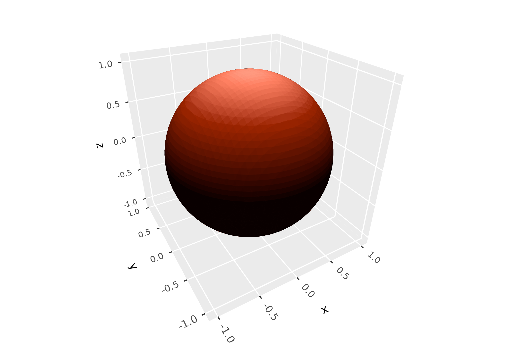

Use `light("none")` to disable lighting entirely, or `light = NULL` in a
layer to inherit the coord-level setting. For a comprehensive guide to
lighting ramps, tones, light direction, and backface handling, see the
[lighting](https://matthewkling.github.io/ggcube/articles/lighting.html)
article.

## Scales, guides, and themes

### Z-axis scales

ggcube provides
[`scale_z_continuous()`](https://matthewkling.github.io/ggcube/reference/scale_z_continuous.md)
and
[`scale_z_discrete()`](https://matthewkling.github.io/ggcube/reference/scale_z_discrete.md)
for controlling the z-axis, with the same interface as their x/y
counterparts.
[`zlim()`](https://matthewkling.github.io/ggcube/reference/zlim.md) is a
shorthand for setting z-axis limits:

``` r

ggplot(mtcars, aes(mpg, wt, z = qsec)) +
      geom_point() +
      zlim(15, 20) +
      coord_3d()
```

### Shaded guides

When lighting is active, standard color guides don’t reflect the shading
visible in the plot. So for lit layers, ggcube uses
[`guide_colorbar_3d()`](https://matthewkling.github.io/ggcube/reference/guide_3d.md)
and
[`guide_legend_3d()`](https://matthewkling.github.io/ggcube/reference/guide_3d.md),
which show the range of shaded colors, in place of the standard guides:

``` r

ggplot(mountain, aes(x, y, z, fill = z)) +
      stat_surface_3d(light = light(direction = c(1, 0, 0))) +
      scale_fill_gradientn(colors = c("tomato", "dodgerblue")) +
      coord_3d()
```

### Panels and themes

The `panels` argument to
[`coord_3d()`](https://matthewkling.github.io/ggcube/reference/coord_3d.md)
controls which cube faces are drawn. Faces behind the data are
“background” panels; faces in front are “foreground” panels (which
default to semi-transparent so they don’t obscure the data):

``` r

ggplot(sphere_points, aes(x, y, z)) +
      geom_hull_3d() +
      coord_3d(panels = "all") +
      theme(panel.background = element_rect(color = "black"),
            panel.border = element_rect(color = "black"),
            panel.foreground = element_rect(alpha = .3),
            panel.grid.foreground = element_line(color = "gray", linewidth = .25),
            axis.text = element_text(color = "darkblue"),
            axis.text.z = element_text(color = "darkred"),
            axis.title = element_text(margin = margin(t = 30)),
            axis.title.x = element_text(color = "magenta"))
```

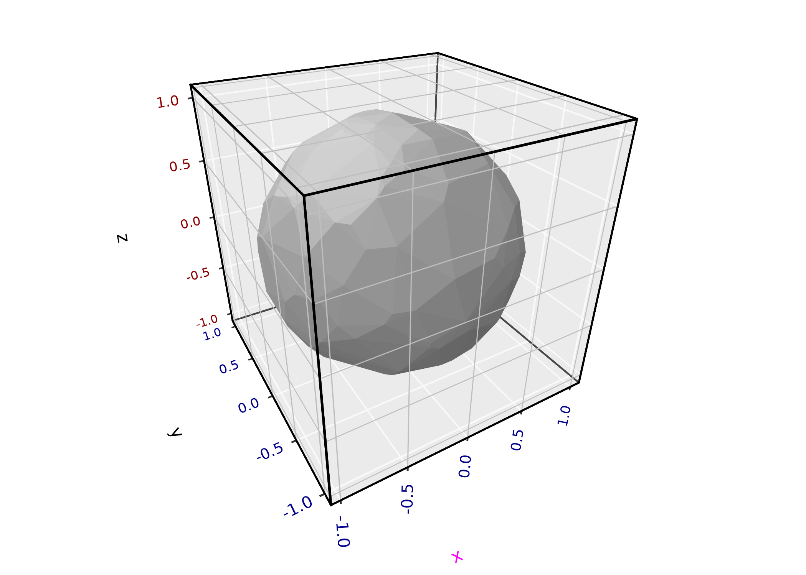

Standard ggplot2 themes and
[`theme()`](https://ggplot2.tidyverse.org/reference/theme.html)
customization work as expected. ggcube adds foreground-specific elements
(`panel.foreground`, `panel.grid.foreground`, `panel.border.foreground`)
and z-axis text elements (`axis.text.z`, `axis.title.z`). ggcube’s
[`element_rect()`](https://matthewkling.github.io/ggcube/reference/element_rect.md)
extends ggplot2’s version with an `alpha` parameter for transparency.
For details, see the theming section of the [3D
coordinates](https://matthewkling.github.io/ggcube/articles/coord_3d.html)
article.

## Annotations

[`annotate_3d()`](https://matthewkling.github.io/ggcube/reference/annotate_3d.md)
adds reference geometry — points, text labels, segments, polygons, axes,
reference lines, or planes — at positions given as parameters, like
ggplot2’s
[`annotate()`](https://ggplot2.tidyverse.org/reference/annotate.html).
All 3D layers in a panel are depth-sorted together, so annotations pass
in front of and behind the plot’s other geometry correctly. Planes,
reference lines, and axes are also available as the layer functions
[`geom_plane_3d()`](https://matthewkling.github.io/ggcube/reference/geom_plane_3d.md),
[`geom_refline_3d()`](https://matthewkling.github.io/ggcube/reference/geom_refline_3d.md),
and
[`geom_axes_3d()`](https://matthewkling.github.io/ggcube/reference/geom_axes_3d.md).

``` r

summit <- filter(mountain, z == max(z))
ggplot(mountain, aes(x, y, z)) +
      geom_contour_3d(fill = "black") +
      annotate_3d("plane", yintercept = .5, fill = "blue", alpha = .25) +
      annotate_3d("point", x = summit$x, y = summit$y, z = summit$z, color = "red") +
      annotate_3d("text", x = summit$x, y = summit$y, z = summit$z, color = "red",
                  label = "Summit", fontface = "bold", vjust = -1) +
      coord_3d(ratio = c(2, 3, 1.5), light = "none")
```

## Mixing 2D and 3D

[`position_on_face()`](https://matthewkling.github.io/ggcube/reference/position_on_face.md)
lets you project layers onto cube faces, enabling a mix of 3D and 2D
content. You can flatten a 3D layer onto a face, or place a natively 2D
layer (like
[`stat_density_2d()`](https://ggplot2.tidyverse.org/reference/geom_density_2d.html))
onto a specific face using the `axes` parameter:

``` r

ggplot(iris, aes(Sepal.Length, Sepal.Width, Petal.Length,
                 color = Species, fill = Species)) +
      coord_3d() + xlim(4, 8) +
      stat_density_2d(position = position_on_face(faces = "zmin", axes = c("x", "y")),
                      geom = "polygon", alpha = .1, linewidth = .25) +
      geom_hull_3d(position = position_on_face("ymax"), alpha = .5) +
      geom_point_3d(shape = 21, color = "black", stroke = .25)
```

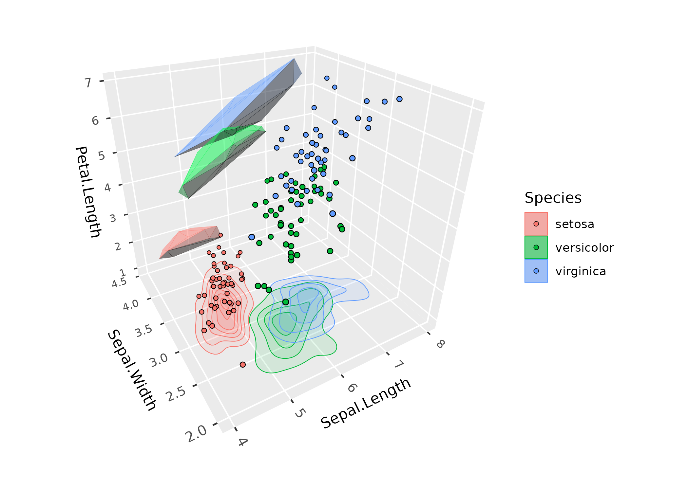

## Animation & multiple views

A major limitation of 3D figures is that you can’t get a full view of
the data from any single angle. One way to mitigate this is by showing
the data from several directions. The facets
[`facet_wrap_views()`](https://matthewkling.github.io/ggcube/reference/facet_wrap_views.md)
and
[`facet_grid_views()`](https://matthewkling.github.io/ggcube/reference/facet_wrap_views.md)
lay out a plot from several angles side by side, like
[`facet_wrap()`](https://ggplot2.tidyverse.org/reference/facet_wrap.html)
and
[`facet_grid()`](https://ggplot2.tidyverse.org/reference/facet_grid.html)
but varying the viewing angle rather than the data:
`p + facet_grid_views(roll ~ yaw)` crosses a range of tilts with a range
of turns. ggcube also offers two options for rotating 3D plots.
[`animate_3d()`](https://matthewkling.github.io/ggcube/reference/animate_3d.md)
makes a gif or movie of a spinning plot across a specified sequence of
rotation angles, while
[`orbit_3d()`](https://matthewkling.github.io/ggcube/reference/orbit_3d.md)
produces an interactive HTML widget that you can drag to rotate. Both
functions take a pre-made plot and a range of rotation angles:

``` r

p <- ggplot(mountain, aes(x, y, z)) +
      geom_contour_3d(fill = "black", color = "white", linewidth = .5) +
      coord_3d(ratio = c(1.5, 2, 1), zoom = 1.25) +
      theme_void()

orbit_3d(p, yaw = c(360, 0), roll = c(-90, 0), n = c(24, 8),
         start = c(yaw = 300, roll = -60))
```

See the [animation, orbits, and multiple
views](https://matthewkling.github.io/ggcube/articles/animation.html)
article for more examples.
