# Lighting and shading

``` r

library(ggcube)
library(patchwork)
theme_set(theme_gray())
theme_update(axis.text = element_blank(),
             axis.title = element_blank())
```

Lighting modifies the fill and/or color of polygon faces based on their
orientation relative to a light source, giving surfaces and volumes a
sense of depth and shape. ggcube’s lighting system only renders **form**
shadows, not **cast** shadows. Lighting can be applied to any
polygon-based 3D layer — surfaces, hulls, bars, voxels, and polygon text
— but is useful mainly for layers where polygon orientation varies.

Lighting colors each face in three steps. First, the angle between the
face and the direction toward the light is measured. Then a *ramp* turns
that angle into how far the face moves toward shadow or highlight: by
default, faces at 45 degrees to the light keep exactly the color you
gave them, faces turned further toward the light are highlighted, and
faces turned further away are shadowed. Finally, a *tone* decides what
lighter and darker look like for a given color: by default, colors
become lighter and darker versions of the same hue.

This vignette covers how to control [what parts](#lighting-targets) of
your plot lighting is applied to, how to change the [visual
qualities](#light-qualities) of the lighting, how to change the
direction of the [light source](#light-sources), how to control how the
[underside](#backface-lighting) of a polygon is lit, and how lighting is
shown in [guides](#id_3d-guides).

We’ll use a common base plot throughout: a sphere, drawn as an
isosurface of a function of x, y, and z. Here it is with default
lighting:

``` r

# a unit sphere, centered at x = x0
sphere <- function(x0 = 0, n = 40, ...) {
  geom_isofunction_3d(fun = function(x, y, z) (x - x0)^2 + y^2 + z^2 - 1,
                      xlim = x0 + c(-1.1, 1.1), ylim = c(-1.1, 1.1), zlim = c(-1.1, 1.1),
                      n = n, ...)
}

p <- ggplot() +
  sphere(fill = "#9e2602") +
  coord_3d(scales = "fixed")
p
```

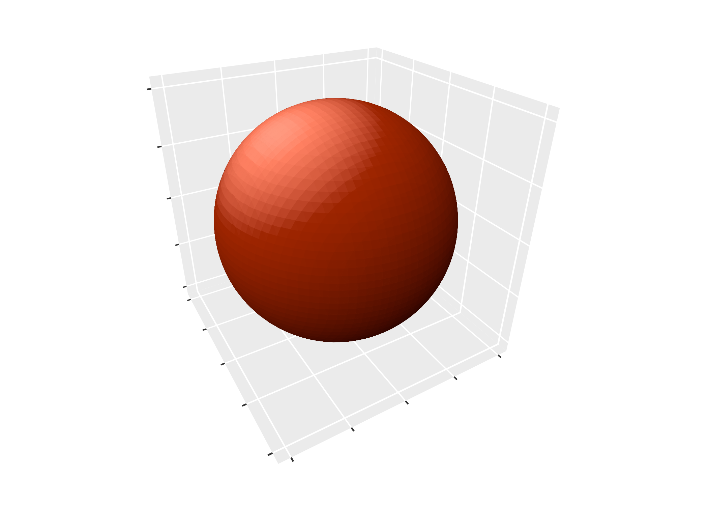

## Lighting targets

Lighting can be set at two levels:

- **Plot-level**: adding `light(...)` to a plot applies it to all
  layers. It can appear anywhere in the plot expression, before or after
  [`coord_3d()`](https://matthewkling.github.io/ggcube/reference/coord_3d.md).
  (Lighting can also be passed to `coord_3d(light = ...)`, which is
  useful when you want a reusable coord object that carries its own
  lighting; supplying it in both places is an error.)
- **Layer-level**: `geom_*_3d(light = light(...))` overrides the
  plot-level setting for that layer.

Use `light("none")` to disable lighting entirely, or `light = NULL` in a
layer to inherit the plot-level setting (the default layer behavior).
Here we add a second layer to our plot, and override the inherited light
settings to disable lighting for this layer:

``` r

p + sphere(x0 = 2.5, fill = "#9e2602", light = "none")
```

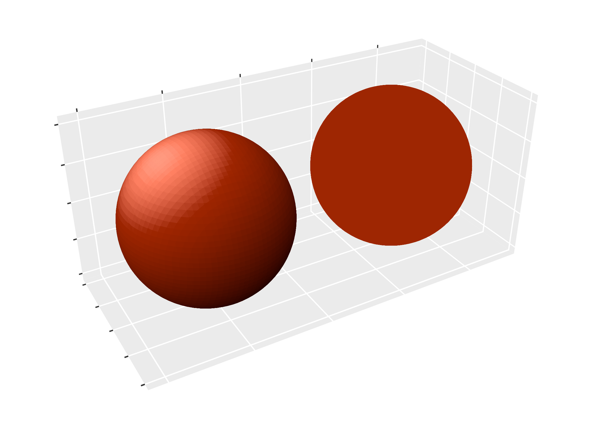

The `fill` and `color` parameters control which aesthetics get modified
by lighting. By default both are `TRUE`. Here a coarser sphere is
outlined in white, which is lit along with the fill by default, and
stays white with `color = FALSE`:

``` r

pw <- ggplot() +
  sphere(n = 12, fill = "#9e2602", color = "white", linewidth = .3) +
  coord_3d(scales = "fixed")
(pw + ggtitle("fill + color (default)")) +
  (pw + light(fill = TRUE, color = FALSE) + ggtitle("fill only"))
```

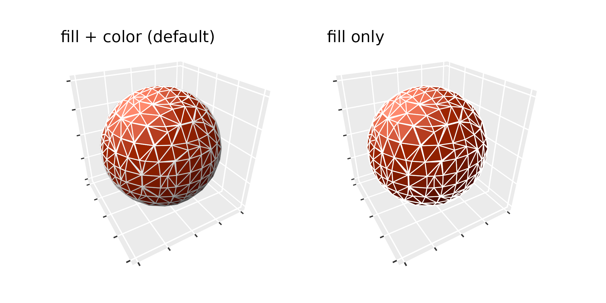

When no color is given, polygon layers outline polygons in their fill
color, which hides the seams between them. These outlines are always lit
along with the fill.

Lighting works with both solid and aesthetically-mapped colors:

``` r

ggplot() +
  sphere(mapping = aes(fill = after_stat(x))) +
  scale_fill_viridis_c() +
  coord_3d(scales = "fixed")
```

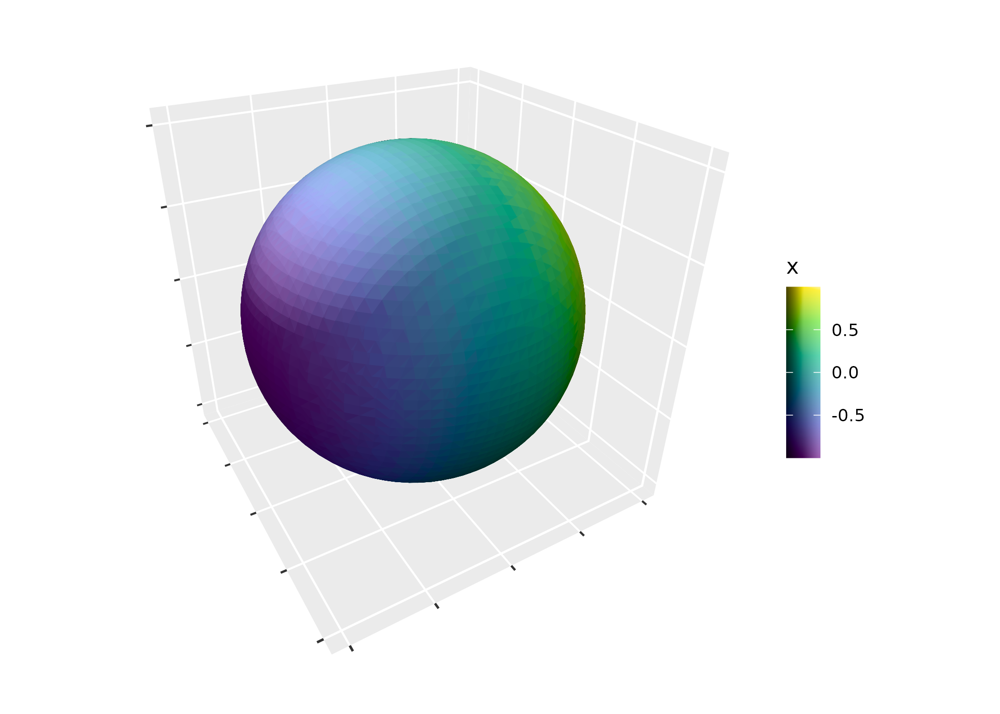

Contours
([`geom_contour_3d()`](https://matthewkling.github.io/ggcube/reference/geom_contour_3d.md))
and ridgelines
([`geom_ridgeline_3d()`](https://matthewkling.github.io/ggcube/reference/geom_ridgeline_3d.md))
are the exception to default lighting: their faces all point the same
way, so lighting could only shift all their colors away from those you
gave them. They are lit only when you set lighting explicitly, with
`+ light()` or their `light` argument.

## Light qualities

### Shadow and highlight strength

`shadow` and `highlight` set how strong shadows and highlights are, from
0 (none) to 1 (fully black or white, with the default tone). By default
shadows are stronger than highlights (`shadow = 0.8`,
`highlight = 0.6`), since fading to black looks more natural than fading
to white:

``` r

(p + light(shadow = 0.4, highlight = 0.3) + ggtitle("subtle")) +
  (p + ggtitle("default")) +
  (p + light(shadow = 1, highlight = 0.9) + ggtitle("strong")) +
  plot_layout(ncol = 3)
```

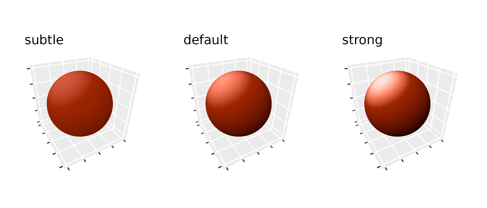

### Ramps

A ramp decides how brightness changes as a surface turns away from the
light:

- **`"smooth"`** (default): Brightness changes gradually. Only surfaces
  pointing directly away from the light source are fully shadowed.
- **`"hard"`**: All surfaces angled 90 degrees or more from the light
  are fully shadowed, giving a sharp edge between lit and unlit sides.
- **`"steps"`**: Brightness falls into flat bands, for a cartoon-like
  look.
- **`"none"`**: Disables lighting across the plot, except for layers
  that declare it themselves.

``` r

(p + ggtitle('"smooth" (default)')) +
  (p + light("hard") + ggtitle('"hard"')) +
  (p + light("steps") + ggtitle('"steps"')) +
  plot_layout(ncol = 3)
```

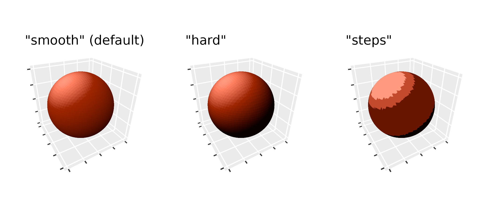

For more control, give a ramp object instead of a name:
[`ramp_smooth()`](https://matthewkling.github.io/ggcube/reference/ramps.md),
[`ramp_hard()`](https://matthewkling.github.io/ggcube/reference/ramps.md),
and
[`ramp_steps()`](https://matthewkling.github.io/ggcube/reference/ramps.md)
take a `neutral` angle, at which faces keep their base color, and
[`ramp_steps()`](https://matthewkling.github.io/ggcube/reference/ramps.md)
takes the number of bands, `n`. A smaller `neutral` angle puts the base
color on faces closer to facing the light, which darkens the plot
overall. Stepped bands run evenly from full highlight to full shadow;
instead of `n` and `neutral`,
[`ramp_steps()`](https://matthewkling.github.io/ggcube/reference/ramps.md)
can take the angles from the light at which bands divide, as `breaks`:

``` r

(p + light(ramp_smooth(neutral = 30)) + ggtitle("ramp_smooth(neutral = 30)")) +
  (p + light(ramp_smooth(neutral = 60)) + ggtitle("ramp_smooth(neutral = 60)")) +
  (p + light(ramp_steps(breaks = c(60, 90))) + ggtitle("ramp_steps(breaks = c(60, 90))")) +
  plot_layout(ncol = 3)
```

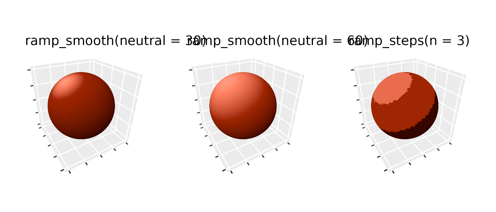

### Tones

A tone decides what lighter and darker look like for a given color:

- **`"lightness"`** (default): Colors become lighter and darker versions
  of the same hue, reaching white at full highlight and black at full
  shadow. Lightness is changed in the perceptual OKLab color space,
  which keeps hue as colors lighten and darken.
- **`"tint"`**: Colors mix toward a chosen highlight color and shadow
  color, for colored light.
- **`"normals"`**: Faces are colored by the direction they face,
  replacing the base colors entirely.

Give
[`tone_tint()`](https://matthewkling.github.io/ggcube/reference/tones.md)
its colors to choose the color of the light. Warm highlights with cool
shadows are a classic choice:

``` r

(p + ggtitle('"lightness" (default)')) +
  (p + light(tone = tone_tint(shadow = "midnightblue", highlight = "lightyellow")) +
      ggtitle("tone_tint()")) +
  (p + light(tone = "normals") + ggtitle('"normals"')) +
  plot_layout(ncol = 3)
```

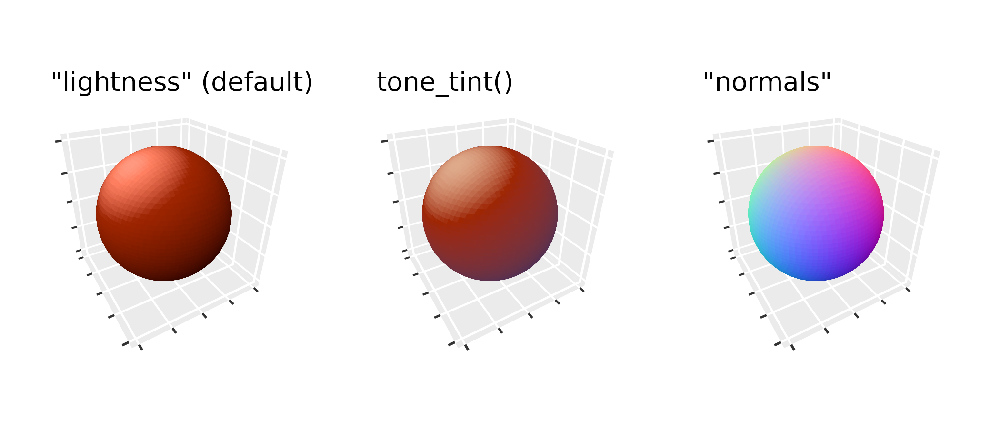

### Specular highlights

`specular` adds glints where faces reflect the light toward the viewer,
as on a glossy surface, from 0 (none, the default) to 1 (reaching the
tone’s full highlight at the center of a glint). `specular_size` sets
how far glints spread, as the angle in degrees by which a face can turn
from reflecting the light straight toward the viewer before its glint
falls to half strength. Glints move toward the tone’s full highlight
color, so colored light gives colored glints, and with stepped ramps
they’re flat spots, like another band:

``` r

(p + light(specular = .8) + ggtitle("specular = .8")) +
  (p + light(specular = .8, tone = tone_tint(shadow = "midnightblue", highlight = "gold")) +
      ggtitle("with tone_tint()")) +
  (p + light(ramp_steps(breaks = c(60, 90)), specular = .8) + ggtitle("with ramp_steps()")) +
  plot_layout(ncol = 3)
```

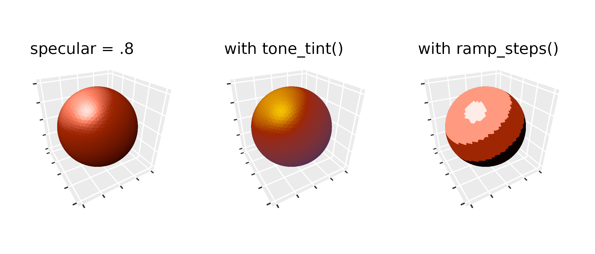

Unlike the rest of lighting, glints depend on the viewing angle, so they
move as a plot rotates. Each face has a single color, so glints work
best on smooth, finely divided surfaces like this sphere: flat faces,
such as those of columns, glint all at once or not at all. Glints can
also make mapped colors hard to read, so they’re best kept for showing
shape.

## Light sources

### Direction and anchoring

The `direction` parameter is a length-3 vector specifying where light
comes from; for example, `direction = c(0, -1, 0)` lights the plot from
the negative y direction. The `anchor` parameter controls whether this
direction is relative to the data axes or the camera:

- **`anchor = "scene"`** (default): Direction is relative to the data
  axes and rotates with the plot. `direction = c(1, 0, 0)` always lights
  surfaces facing the “xmax” face.
- **`anchor = "camera"`**: Direction is fixed relative to the viewing
  pane. `direction = c(1, 0, 0)` always lights surfaces facing the right
  side of the plot, regardless of rotation.

``` r

(p + light("hard", direction = c(0, -1, 0)) + ggtitle('anchor = "scene"')) +
  (p + light("hard", direction = c(0, -1, 0), anchor = "camera") +
      ggtitle('anchor = "camera"'))
```

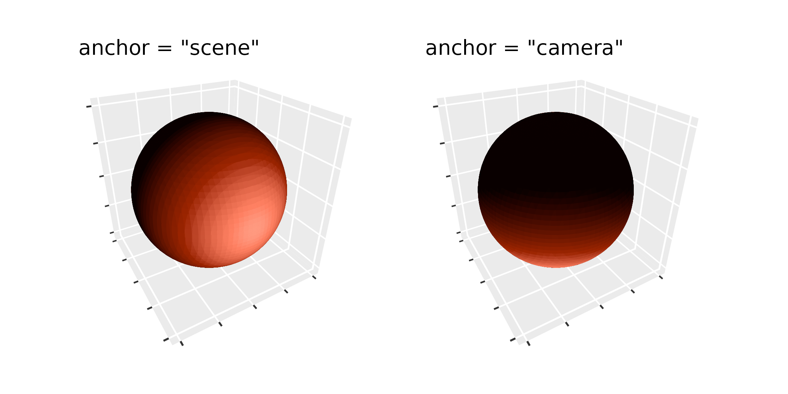

Directions can also be given as angles with
[`direction()`](https://matthewkling.github.io/ggcube/reference/direction.md),
which takes an azimuth (a compass bearing, measured clockwise from the
positive y axis) and an elevation (degrees above the xy plane). This is
often easier when you want to raise or lower a light without changing
which side it comes from. The default light comes from the negative x
side (an azimuth of 270), 60 degrees above the horizon. Here it is low
and then overhead:

``` r

(p + light("hard", direction = direction(270, 10)) + ggtitle("elevation 10")) +
  (p + light("hard", direction = direction(270, 90)) + ggtitle("elevation 90"))
```

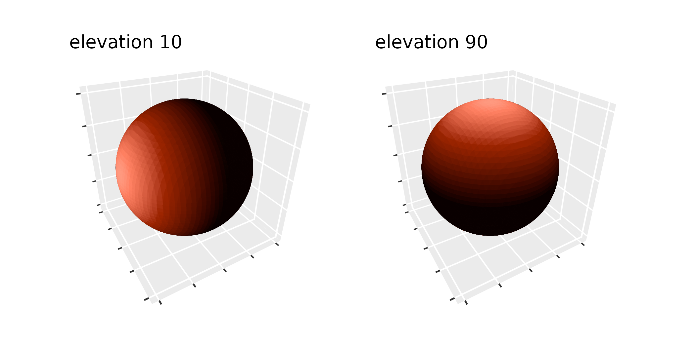

Printing a light shows its direction both ways, which can help in
translating between the two:

``` r

light(direction = c(-1, -1, 1))
#> Lighting specification:
#>   Ramp: smooth (neutral 45 deg) 
#>   Tone: lightness 
#>   Strength: shadow 0.8 , highlight 0.6 
#>   Direction: [ -1, -1, 1 ] (directional lighting)
#>     azimuth: 225 deg, elevation: 35.3 deg
#>   anchor: scene 
#>   Lights: fill + color
```

To compare light directions side by side, or to move the light around
interactively, see the `light_azimuth` and `light_elevation` arguments
of
[`orbit_3d()`](https://matthewkling.github.io/ggcube/reference/orbit_3d.md)
and
[`animate_3d()`](https://matthewkling.github.io/ggcube/reference/animate_3d.md),
and the view facets
[`facet_wrap_views()`](https://matthewkling.github.io/ggcube/reference/facet_wrap_views.md)
and
[`facet_grid_views()`](https://matthewkling.github.io/ggcube/reference/facet_wrap_views.md),
covered in the [animation and multiple
views](https://matthewkling.github.io/ggcube/articles/animation.md)
article.

### Positional lighting

In addition to directional lighting (parallel rays from a direction),
ggcube also supports positional lighting from a point source. Use
`position` instead of `direction` to specify a light source location in
data coordinates. Setting `distance_falloff = TRUE` applies
inverse-square intensity falloff from the light source position.

``` r

ggplot(mountain, aes(x, y, z)) +
  stat_surface_3d(fill = "red", color = "red") +
  coord_3d(
    light = light(position = c(.5, .7, 95), distance_falloff = TRUE),
    ratio = c(1.5, 2, 1))
```

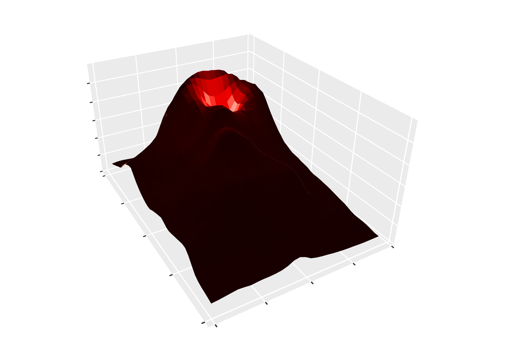

## Backface lighting

A backface is the side of a polygon facing the underside of a surface or
the inside of a volume. By default, backfaces receive inverted lighting
relative to frontfaces (`backface_scale = -1`), creating strong visual
contrast between the two sides. Setting `backface_scale = 1` lights
backfaces the same as frontfaces. Modifying `backface_offset` to
uniformly darkens or brightens all backfaces.

``` r

pb <- ggplot() +
  geom_function_3d(fun = function(x, y) x^2 + y^2,
                   xlim = c(-3, 3), ylim = c(-3, 3),
                   fill = "steelblue", color = "steelblue") +
      coord_3d(pitch = 0, roll = -70, yaw = 0)

(pb +
    ggtitle("default:\nbackface_scale = -1\nbackface_offset = 0")) +
  (pb + light(backface_scale = 1) +
      ggtitle("\nbackface_scale = 1\nbackface_offset = 0")) +
  (pb + light(backface_scale = 1, backface_offset = -.5) +
      ggtitle("\nbackface_scale = 1\nbackface_offset = -0.5")) +
  plot_layout(nrow = 1)
```

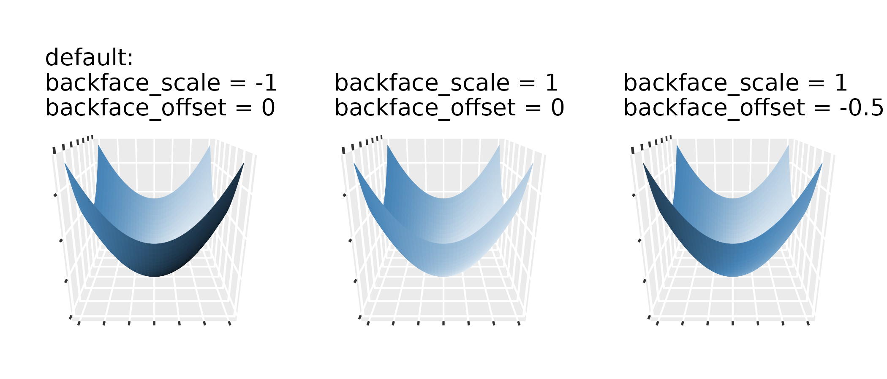

## 3D guides

When lighting is active, standard color guides don’t reflect the range
of shaded colors visible in the plot. So when lighting applies to a
layer that maps `fill` or `color`, ggcube uses
[`guide_colorbar_3d()`](https://matthewkling.github.io/ggcube/reference/guide_3d.md)
and
[`guide_legend_3d()`](https://matthewkling.github.io/ggcube/reference/guide_3d.md)
in place of the standard guides, showing the shading gradient alongside
each color, with the colors as given in the middle:

``` r

ggplot(mountain, aes(x, y, z, fill = z)) +
  stat_surface_3d() +
  light(direction = c(1, 0, 0)) +
  scale_fill_gradientn(colors = c("tomato", "dodgerblue")) +
  coord_3d(ratio = c(2, 3, 1.5))
```

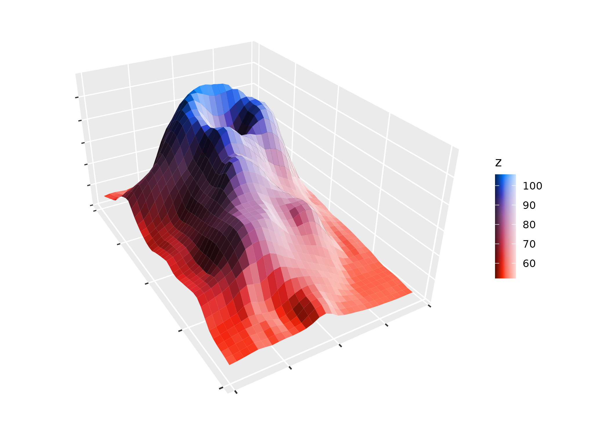

``` r

ggplot(mountain, aes(x, y, z, fill = x > .5, group = 1)) +
  stat_surface_3d() +
  light(direction = c(1, 0, 0)) +
  coord_3d(ratio = c(2, 3, 1.5))
```

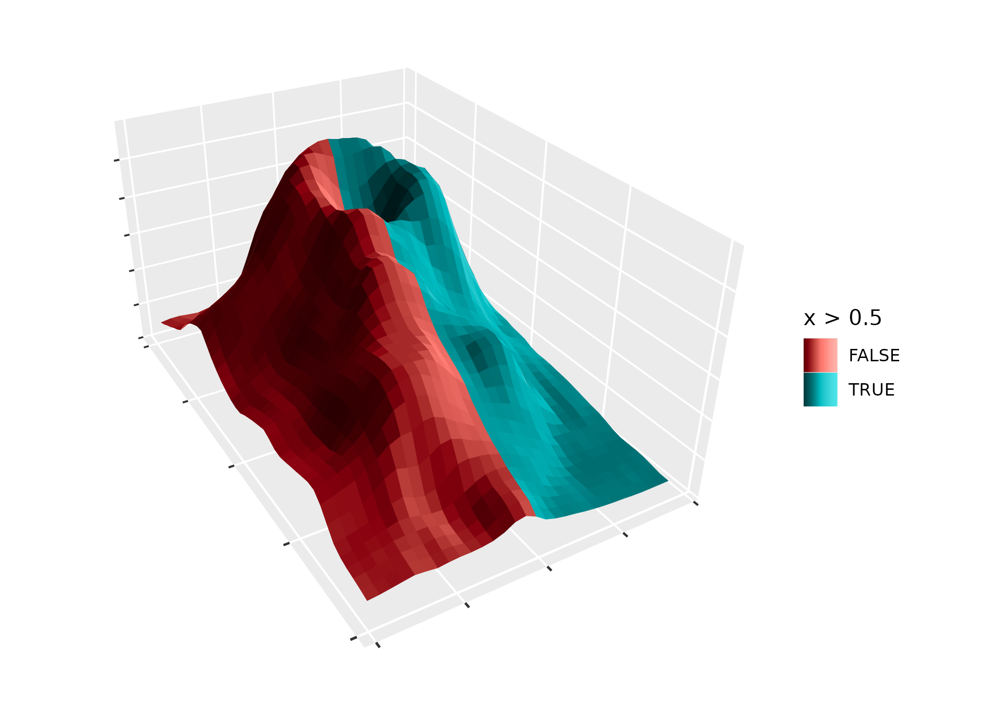

Call the guides yourself to change their options: both accept
`shade_range` to control the range of shading shown (a length-2 vector
from -1, full shadow, to 1, full highlight), and `reverse_shade` to flip
the gradient direction. For an unshaded guide, ask for a standard one,
e.g. `guides(fill = "colourbar")`.

``` r

ggplot(mountain, aes(x, y, z, fill = z)) +
  stat_surface_3d() +
  light(direction = c(1, 0, 0)) +
  guides(fill = guide_colorbar_3d(shade_range = c(-1, 1))) +
  scale_fill_gradientn(colors = c("tomato", "dodgerblue")) +
  coord_3d(ratio = c(2, 3, 1.5))
```

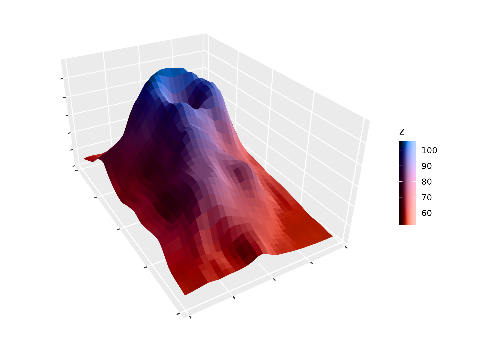

Note that when fill and color map to the same variable, ggplot2 creates
a shared scale. In this case, set the 3D guide’s options via
`guides(fill = guide_colorbar_3d())`, not via the color guide.
