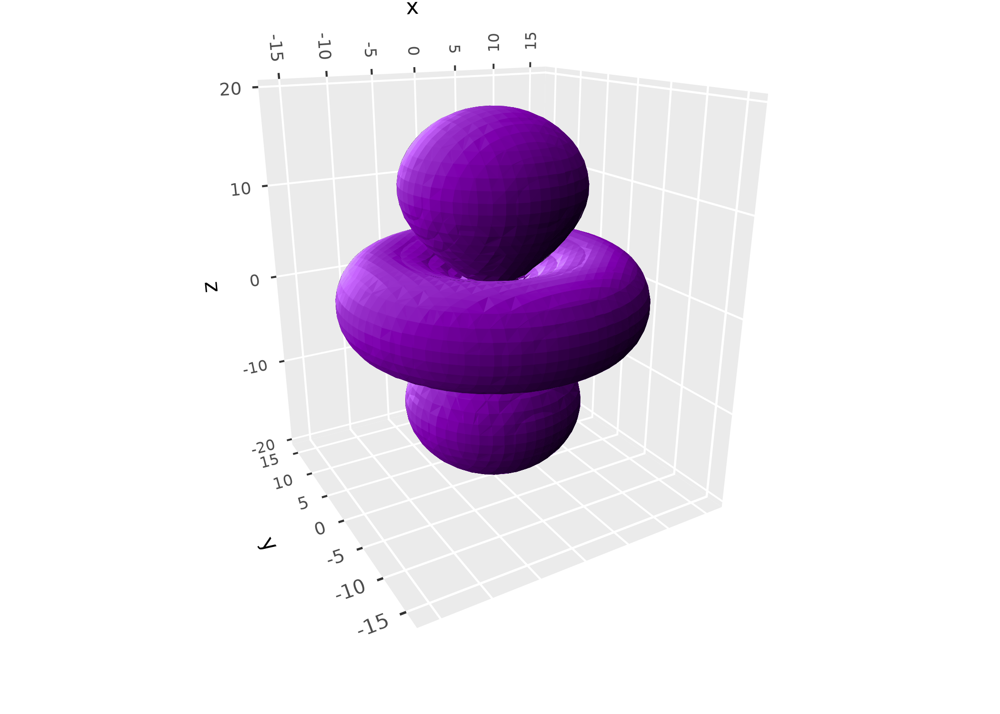
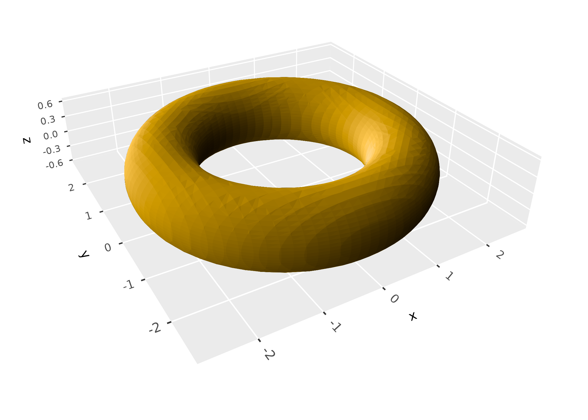
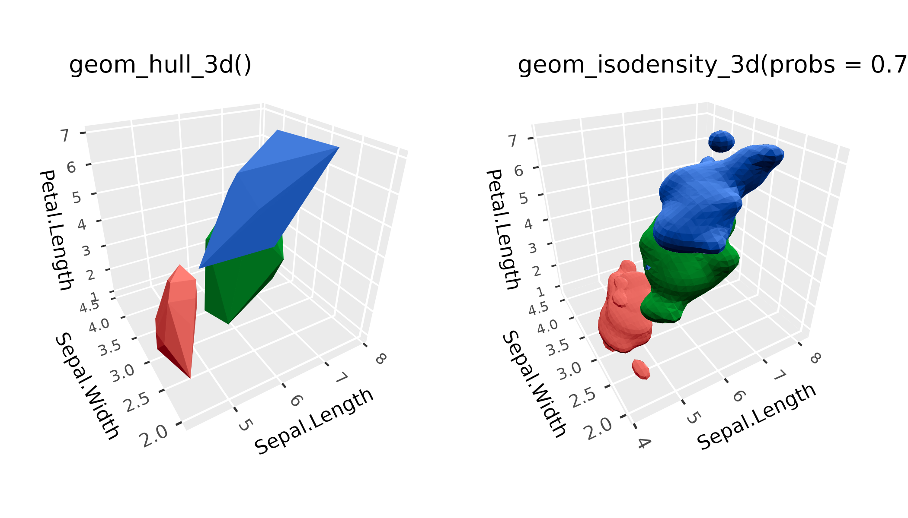
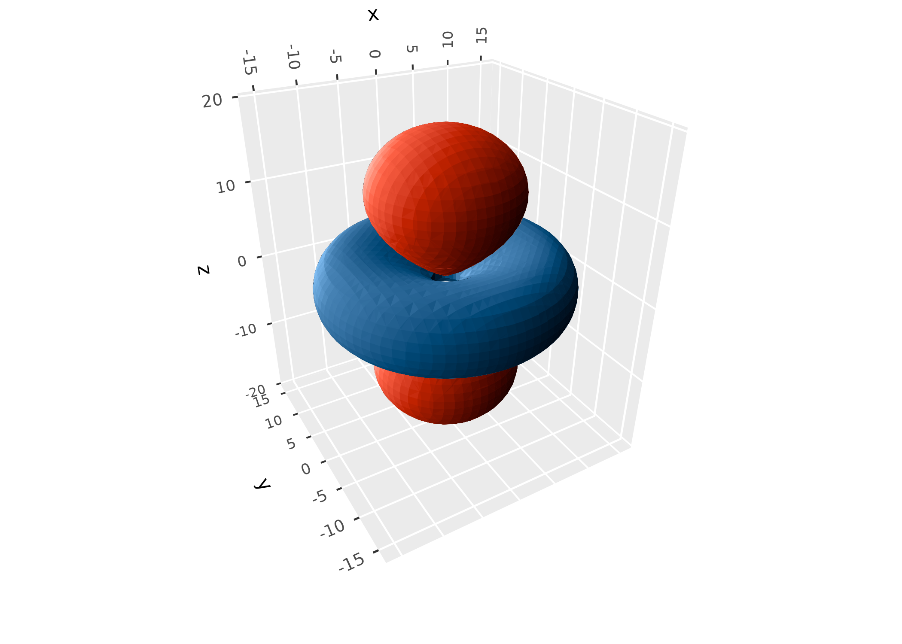
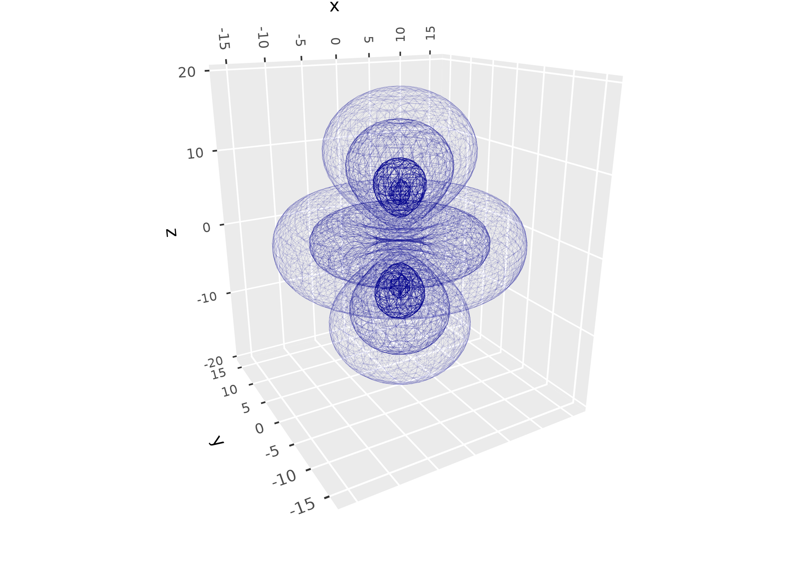
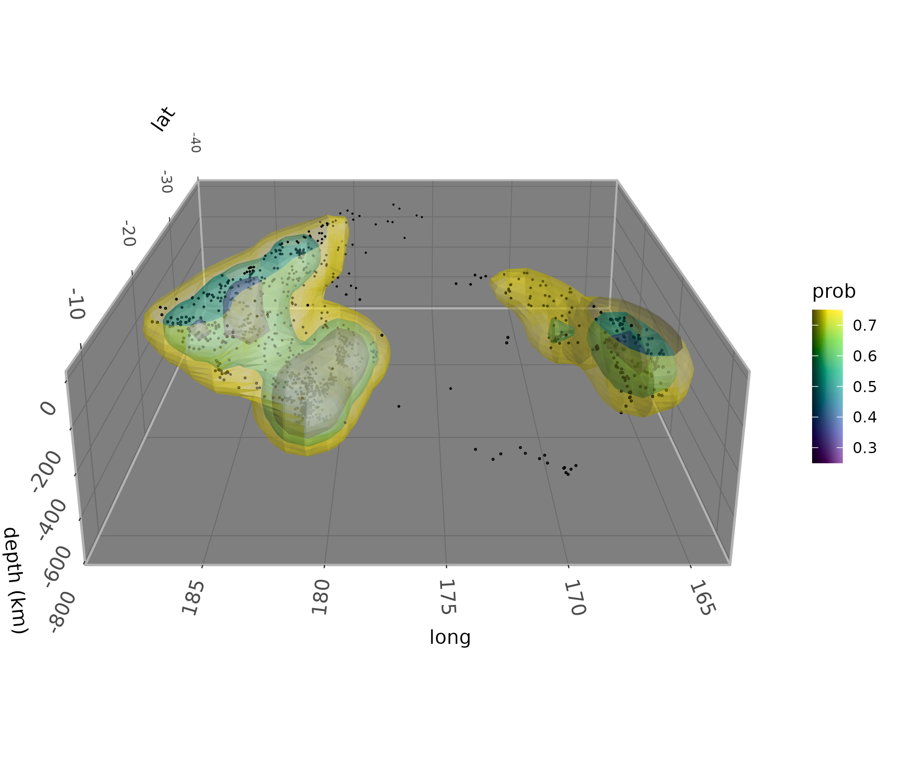
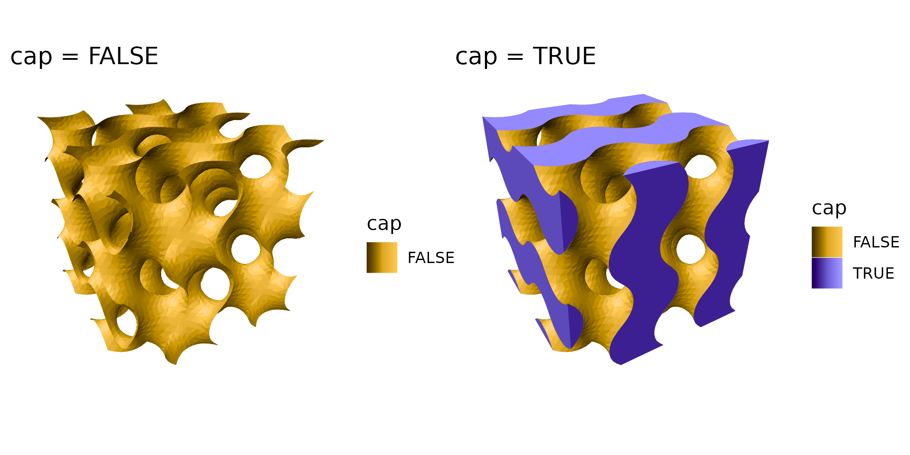
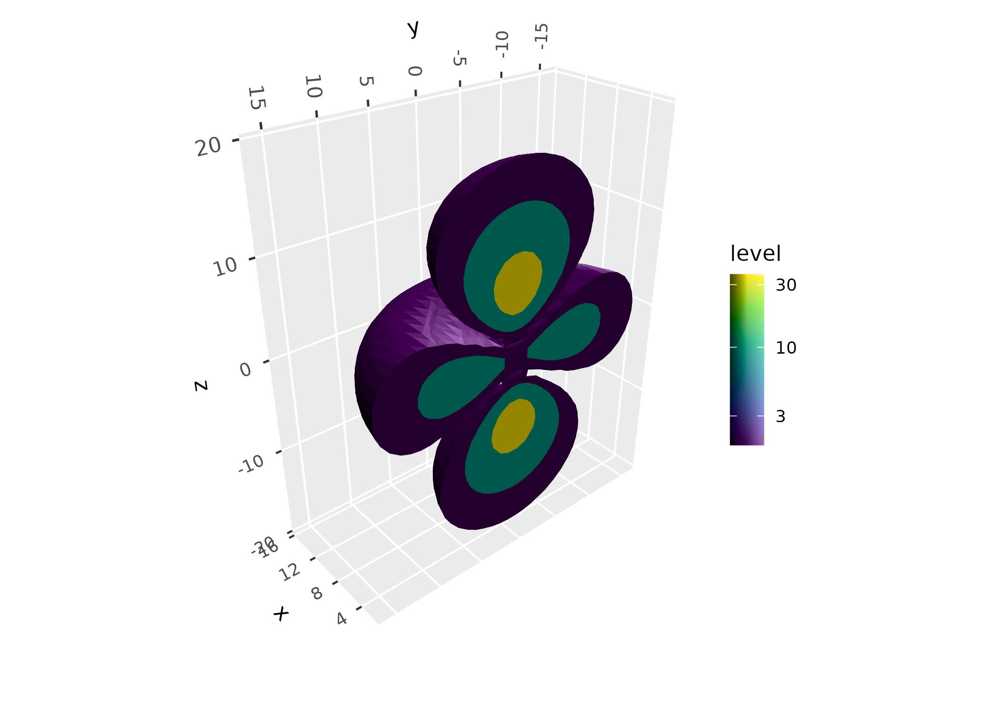
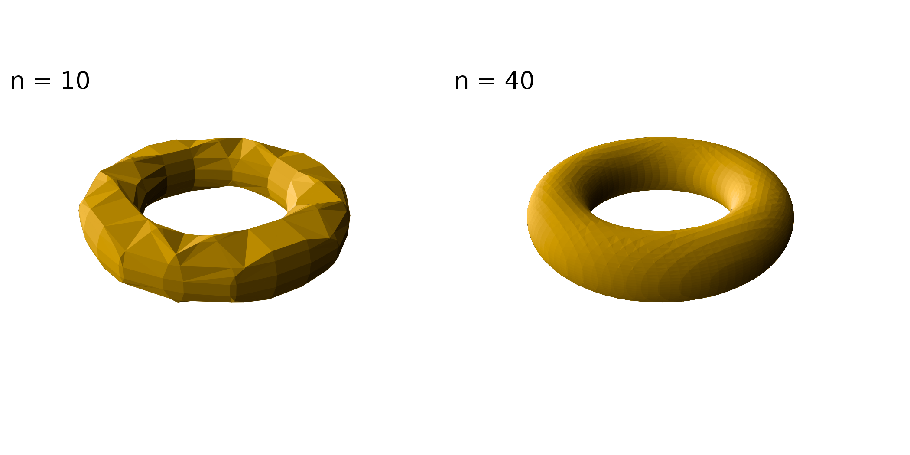

# Volumes

``` r

library(ggcube)
library(patchwork)
```

The
[surfaces](https://matthewkling.github.io/ggcube/articles/surfaces.md)
article covers surfaces with a single z value for each (x, y) position,
like terrain. This article covers volumes: regions of 3D space, drawn as
the surfaces that bound them. Unlike terrain, these surfaces can fold
over, nest inside one another, and close on themselves.

ggcube draws most volumes as **isosurfaces**: the surfaces on which some
quantity defined throughout 3D space equals a given value. They’re the
3D analog of contour lines. The quantity can come from three kinds of
source, each of which has a lower-dimensional counterpart among the
surface layers:

| Source | Surface: z = f(x, y) | Volume: f(x, y, z) = c |
|----|----|----|
| Gridded data | [`geom_surface_3d()`](https://matthewkling.github.io/ggcube/reference/stat_surface_3d.md) | [`geom_isosurface_3d()`](https://matthewkling.github.io/ggcube/reference/geom_isosurface_3d.md) |
| A function | [`geom_function_3d()`](https://matthewkling.github.io/ggcube/reference/stat_function_3d.md) | [`geom_isofunction_3d()`](https://matthewkling.github.io/ggcube/reference/geom_isofunction_3d.md) |
| The density of points | [`geom_density_3d()`](https://matthewkling.github.io/ggcube/reference/stat_density_3d.md) | [`geom_isodensity_3d()`](https://matthewkling.github.io/ggcube/reference/geom_isodensity_3d.md) |

[`geom_hull_3d()`](https://matthewkling.github.io/ggcube/reference/geom_hull_3d.md),
which wraps point clouds in convex or alpha hulls, is covered here too.

The isosurface layers triangulate surfaces with the marching cubes
algorithm, from the {rmarchingcubes} package, which must be installed:

``` r

install.packages("rmarchingcubes")
```

## Data sources

### Gridded data

Where
[`geom_surface_3d()`](https://matthewkling.github.io/ggcube/reference/stat_surface_3d.md)
takes a grid of heights over x and y,
[`geom_isosurface_3d()`](https://matthewkling.github.io/ggcube/reference/geom_isosurface_3d.md)
takes a grid of values over x, y, and z, mapped to the `value`
aesthetic: a 3D raster, model output, a medical scan, or the like. The
data need a row for every combination of `x`, `y`, and `z` values, such
as from [`expand.grid()`](https://rdrr.io/r/base/expand.grid.html),
though the spacing doesn’t have to be regular. The `levels` argument
gives the values at which to draw surfaces, defaulting to the midpoint
of the range of `value`.

Here’s the probability density of an electron in a hydrogen atom’s 3d
orbital, the square of its wave function, which is largest in two lobes
and a ring:

``` r

s <- seq(-20, 20, length.out = 40)
orbital <- expand.grid(x = s, y = s, z = s)
orbital$psi <- with(orbital, (3 * z^2 - (x^2 + y^2 + z^2)) *
                          exp(-sqrt(x^2 + y^2 + z^2) / 3))

ggplot(orbital, aes(x, y, z, value = psi^2)) +
      geom_isosurface_3d(levels = 0.02 * max(orbital$psi^2), fill = "darkorchid") +
      coord_3d(scales = "fixed", roll = -70) +
      light(direction = c(-1, 1, 1))
```



### Functions

Where
[`geom_function_3d()`](https://matthewkling.github.io/ggcube/reference/stat_function_3d.md)
draws the surface z = f(x, y) of a function of two variables,
[`geom_isofunction_3d()`](https://matthewkling.github.io/ggcube/reference/geom_isofunction_3d.md)
draws the surfaces f(x, y, z) = c of a function of three. The function
is evaluated over a grid spanning the domain given by `xlim`, `ylim`,
and `zlim`, at a resolution set by `n`. By default it draws the
*implicit surface* f(x, y, z) = 0, enclosing the region where the
function is negative, which is how implicit surfaces are usually
written. A torus, for example, is the set of points at a given distance
from a circle:

``` r

torus <- function(x, y, z) (sqrt(x^2 + y^2) - 2)^2 + z^2 - 0.6^2

ggplot() +
      geom_isofunction_3d(fun = torus, n = 40,
                          xlim = c(-3, 3), ylim = c(-3, 3), zlim = c(-1, 1),
                          fill = "goldenrod") +
      coord_3d(scales = "fixed") +
      light(direction = c(-1, 1, .5))
```



### Point clouds

Whereas
[`geom_density_3d()`](https://matthewkling.github.io/ggcube/reference/stat_density_3d.md)
estimates the density of points in two dimensions and draws it as a
surface,
[`geom_isodensity_3d()`](https://matthewkling.github.io/ggcube/reference/geom_isodensity_3d.md)
estimates their density in three dimensions and draws surfaces enclosing
given fractions of it, by default the densest half. Its `h` and `adjust`
arguments control the bandwidth of the kernel density estimate, and `n`
its resolution.

[`geom_hull_3d()`](https://matthewkling.github.io/ggcube/reference/geom_hull_3d.md)
takes a different approach to point clouds, wrapping them in convex
hulls or, with `method = "alpha"`, alpha hulls. Hulls show the full
extent of the points, outliers included, while density surfaces show
where they concentrate:

``` r

p <- ggplot(iris, aes(Sepal.Length, Sepal.Width, Petal.Length,
                      fill = Species, color = Species)) +
      coord_3d() +
      light(direction = c(1, 1, 1)) +
      theme(legend.position = "none")

(p + geom_hull_3d() + ggtitle("geom_hull_3d()")) +
      (p + geom_isodensity_3d(probs = 0.75) + ggtitle("geom_isodensity_3d(probs = 0.75)"))
```



## Inside and outside

Each isosurface divides space in two, and faces outward from the region
it encloses, its inside.
[`geom_isosurface_3d()`](https://matthewkling.github.io/ggcube/reference/geom_isosurface_3d.md)
and
[`geom_isodensity_3d()`](https://matthewkling.github.io/ggcube/reference/geom_isodensity_3d.md)
enclose the regions where values exceed the level, which suits densities
and concentrations, while
[`geom_isofunction_3d()`](https://matthewkling.github.io/ggcube/reference/geom_isofunction_3d.md)
encloses those where they’re below it, following the convention for
implicit surfaces.
[`geom_isosurface_3d()`](https://matthewkling.github.io/ggcube/reference/geom_isosurface_3d.md)
and
[`geom_isofunction_3d()`](https://matthewkling.github.io/ggcube/reference/geom_isofunction_3d.md)
take an `inside` argument to choose the other side.

The wave function of the orbital above is positive in its lobes and
negative in its ring. To draw both, enclose the region above a positive
level in one layer, and below a negative one in another:

``` r

level <- 0.15 * max(abs(orbital$psi))

ggplot(orbital, aes(x, y, z, value = psi)) +
      geom_isosurface_3d(levels = level, fill = "tomato") +
      geom_isosurface_3d(levels = -level, inside = "below", fill = "steelblue") +
      coord_3d(scales = "fixed") +
      light(direction = c(-1, 1, .5))
```



Which side is inside makes no difference to how a closed surface looks
with ggcube’s default lighting, but it does set which way surfaces face.
That determines which side gets a cap where surfaces are cut (see
below), which triangles `cull_backfaces = TRUE` removes, and the
direction of the computed `normal_x`, `normal_y`, and `normal_z`
variables.

## Nested surfaces

Specifying multiple values for `levels`, or for `probs` in
[`geom_isodensity_3d()`](https://matthewkling.github.io/ggcube/reference/geom_isodensity_3d.md),
gives nested surfaces. These surfaces hide one another with the default
opaque fill, so you can use wireframes or translucent fills to view the
internal structure. Opaque surfaces are outlined in their fill color by
default, to hide seams between triangles, while translucent ones aren’t
outlined. These stats produce computed variables `level` or `prob` that
you can map aesthetics to, to tell them apart.

Here’s the atomic orbital, with multiple levels shown simultaneously,
drawn as a wireframe with line opacity mapped to point density:

``` r

ggplot(orbital, aes(x, y, z, value = psi^2)) +
      geom_isosurface_3d(aes(alpha = after_stat(level)),
                         levels = c(0.02, 0.10, .50, .90) * max(orbital$psi^2), 
                         fill = NA, color = "darkblue", show.legend = FALSE) +
      coord_3d(scales = "fixed", roll = -70) +
      light("none")
```



And here are the earthquakes in the `quakes` dataset, whose densest
regions trace the Tonga slab subducting under the Pacific plate:

``` r

ggplot(quakes, aes(long, lat, -depth)) +
      geom_isodensity_3d(alpha = .4, aes(fill = after_stat(prob)),
                         probs = c(0.25, 0.5, 0.75)) +
      geom_point_3d(size = 0.2) +
      scale_fill_viridis_c() +
      coord_3d(yaw = 180, roll = -70, scales = "fixed", ratio = c(1, 1, .01)) +
      labs(z = "depth (km)") +
      light(direction = c(-1, 1, 1)) +
      zlim(NA, 0) +
      theme_dark() + 
      theme(panel.border = element_rect(color = "gray70"))
```



## Cutaways

Limits on the plot’s scales cut isosurfaces cleanly where they cross
them, leaving them open there. With `cap = TRUE`, they’re closed with
flat caps instead, showing solid cross sections.
[`geom_isosurface_3d()`](https://matthewkling.github.io/ggcube/reference/geom_isosurface_3d.md)
and
[`geom_isofunction_3d()`](https://matthewkling.github.io/ggcube/reference/geom_isofunction_3d.md)
also cap surfaces where they meet the edges of their grid or domain. The
computed `cap` variable identifies caps, e.g. to color them differently.

Here’s the gyroid function, shown with and without caps where it exits
the cube:

``` r

gyroid <- function(x, y, z) sin(x) * cos(y) + sin(y) * cos(z) + sin(z) * cos(x)
p <- ggplot() + coord_3d() + theme_void() +
      scale_fill_manual(values = c("goldenrod", "slateblue"))
cut_torus <- function(cap) {
      geom_isofunction_3d(aes(fill = after_stat(cap)), fun = gyroid, cap = cap, n = 40,
                          xlim = c(0, 4 * pi), ylim = c(0, 4 * pi), zlim = c(0, 4 * pi))
}

(p + cut_torus(FALSE) + ggtitle("cap = FALSE")) +
      (p + cut_torus(TRUE) + ggtitle("cap = TRUE"))
```



Caps of nested surfaces tile the cut, each spanning the band between its
level and the next, so a cutaway through nested surfaces shows their
cross sections like a 2D density contour map. Here’s the orbital’s
probability density at three levels, cut through its lobes and ring:

``` r

ggplot(orbital, aes(x, y, z, value = psi^2, fill = after_stat(level))) +
      geom_isosurface_3d(levels = c(0.02, 0.1, 0.4) * max(orbital$psi^2), cap = TRUE) +
      scale_fill_viridis_c(trans = "log10") +
      coord_3d(scales = "fixed", yaw = -130) +
      light(direction = c(0, -1, 1)) +
      xlim(2, NA)
```



As elsewhere in ggplot2, limits remove data outside them before the
layer’s stat is computed. For point clouds, that changes the density.
For gridded data like the orbital’s, it just trims the grid, though
ggplot2 warns about rows removed by x and y limits.

## Practicalities

### Resolution and speed

Isosurfaces are made of triangles, roughly in proportion to the square
of the grid’s resolution, and drawing time grows with the number of
triangles. `n` sets the resolution of
[`geom_isofunction_3d()`](https://matthewkling.github.io/ggcube/reference/geom_isofunction_3d.md)
and
[`geom_isodensity_3d()`](https://matthewkling.github.io/ggcube/reference/geom_isodensity_3d.md),
defaulting to 30 points along each axis; for
[`geom_isosurface_3d()`](https://matthewkling.github.io/ggcube/reference/geom_isosurface_3d.md),
it’s the resolution of the data. Coarse grids give faceted surfaces, and
fine ones smooth but slow ones:

``` r

p <- ggplot() +
      coord_3d(scales = "fixed", panels = "none") +
      light(direction = c(-1, 1, .5)) +
      theme_void()
resolution <- function(n) {
      p + geom_isofunction_3d(fun = torus, n = n, fill = "goldenrod",
                              xlim = c(-3, 3), ylim = c(-3, 3), zlim = c(-1, 1)) +
            ggtitle(paste("n =", n))
}

resolution(10) + resolution(40)
```



For opaque surfaces that close on themselves, `cull_backfaces = TRUE`
removes the triangles facing away from the viewer, which are hidden
anyway, saving some drawing time.

### Lighting

Isosurfaces are lit like other ggcube surfaces; see the
[lighting](https://matthewkling.github.io/ggcube/articles/lighting.md)
article. Since lighting is computed per triangle, coarse surfaces show
their facets, especially under strong or hard lighting.
